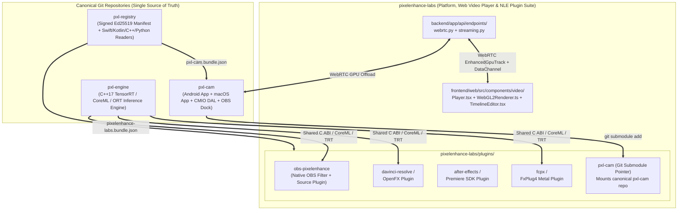
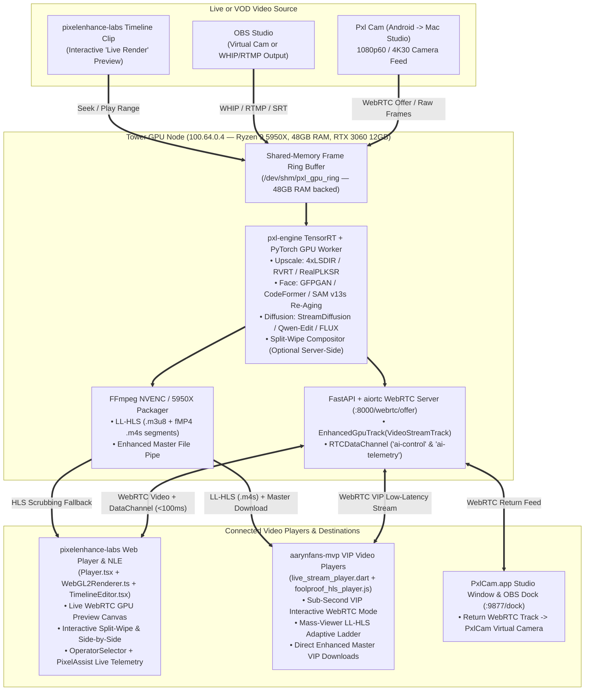
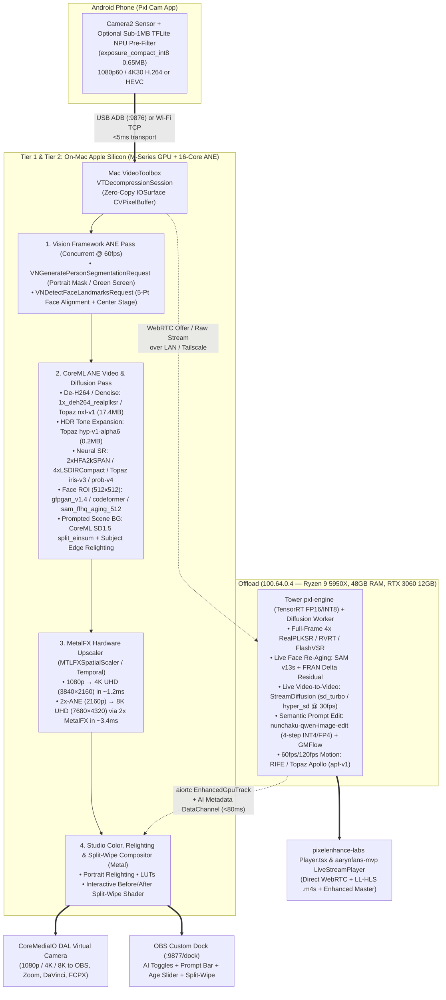
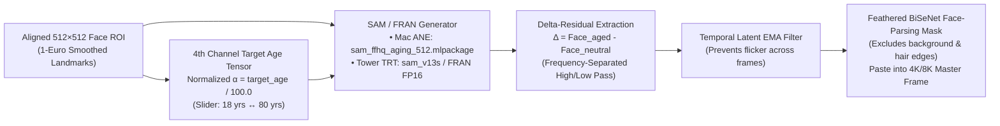
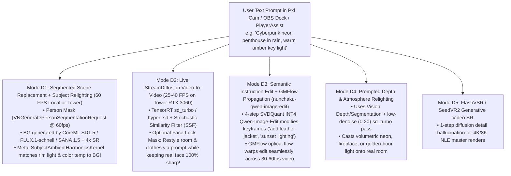

# Pxl Cam — Standalone / Submodule Architecture, Real-Time 4K/8K CoreML & MetalFX Video Pipeline, Diffusion Scene & Face Re-Aging Studio, and Tower WebRTC GPU Streaming

**Last Updated:** October 2026  
**Repositories & Compute Fleet Covered:**
- **Mac Studio / MacBook Pro (`100.64.0.3`):** [`pxl-cam`](file:///Users/aaryn/Projects/pxl-cam), [`pixelenhance-labs`](file:///Users/aaryn/Projects/pixelenhance-labs), [`aarynfans-mvp`](file:///Users/aaryn/Projects/aarynfans-mvp), [`pixelspark-ios`](file:///Users/aaryn/Projects/pixelspark-ios), [`pxl-engine`](file:///Users/aaryn/Projects/pxl-engine), [`pxl-registry`](file:///Users/aaryn/Projects/pxl-registry)
- **Tower Dedicated GPU Node (`aaryn@100.64.0.4` / LAN `192.168.1.129`):** **AMD Ryzen 9 5950X (16-Core / 32-Thread)**, **48 GB DDR4 RAM** *(currently running on 16 GB installed while the 32 GB kit returns from RMA)*, **NVIDIA RTX 3060 12 GB (`sm_86` Ampere)**, 915 GB NVMe, Ubuntu 24.04
- **ASUS GPU & Master Model Node (`aaryn@100.64.0.6`):** **AMD Ryzen 9 4900H (8-Core / 16-Thread)**, **16 GB RAM**, **NVIDIA RTX 2060 (`sm_75` Turing)**, `/mnt/storage/models` (594 GB local master model store)
- **Backblaze B2 Master Model Cloud (`b2://pixelenhance-models` / Bucket `4f5fcf7884481b01a41b071a`):** 14,757 objects across `topaz/` (975 CoreML `.mlpackage`/`.mlmodel` files + 76 JSON configs), `production/` (125 files), `onnx/` (42 files), `cold-archive/2026H2/`, and `research/2026H2/`

---

## Table of Contents

1. [How Standalone + Git Submodule Works (One Repo, Zero Duplication)](#1-how-standalone--git-submodule-works-one-repo-zero-duplication)
2. [Recap: Your WebRTC + Tower (`100.64.0.4`) & ASUS (`100.64.0.6`) Architecture](#2-recap-your-webrtc--tower-1006404--asus-1006406-architecture)
3. [How WebRTC Connects to the `pixelenhance-labs` and `aarynfans-mvp` Video Players](#3-how-webrtc-connects-to-the-pixelenhance-labs-and-aarynfans-mvp-video-players)
4. [CoreML, Topaz ANE, ONNX & TFLite Model Inventory Across Mac, ASUS & B2](#4-coreml-topaz-ane-onnx--tflite-model-inventory-across-mac-asus--b2)
5. [Real-Time 4K & 8K AI Video Pipeline in `Pxl Cam`](#5-real-time-4k--8k-ai-video-pipeline-in-pxl-cam)
6. [Face Enhancement, Live Face Re-Aging (`SAM` / `FRAN` / `VISAGE`), & Interactive Split-Wipe Mode](#6-face-enhancement-live-face-re-aging-sam--fran--visage--interactive-split-wipe-mode)
7. [Real-Time & Prompt-Driven Diffusion Models (Text-Prompted Scene Change, `StreamDiffusion`, Semantic Edits & Video SR)](#7-real-time--prompt-driven-diffusion-models-text-prompted-scene-change-streamdiffusion-semantic-edits--video-sr)
8. [Complete, End-to-End Engineering Implementation Plan (Phases 1–8 — Every Feature in Detail)](#8-complete-end-to-end-engineering-implementation-plan-phases-18--every-feature-in-detail)

---

## 1. How Standalone + Git Submodule Works (One Repo, Zero Duplication)

### Yes — `pxl-cam` Remains **One Single Canonical Repository**

When `pxl-cam` is mounted as a Git submodule inside `pixelenhance-labs` (at `pixelenhance-labs/plugins/pxl-cam`), **there are never two separate codebases to maintain**:

1. **One Canonical Git Repository (`github.com/aabiro/pxl-cam`):**
   - You can open `/Users/aaryn/Projects/pxl-cam` directly as a standalone repo, build the Android APK (`./gradlew assembleDebug`), build `PxlCam.app` (`./mac/build.sh`), push commits, and cut standalone DMG/APK releases for users who only want the pro camera + virtual webcam studio.
2. **A 40-Byte Commit SHA Pointer in `pixelenhance-labs`:**
   - Inside `pixelenhance-labs`, Git does **not** duplicate `pxl-cam`'s files into `pixelenhance-labs`'s tree. Instead, `pixelenhance-labs` stores a `.gitmodules` entry and a lightweight commit pointer to `pxl-cam`.
   - Running `git clone --recurse-submodules` (or `git submodule update --init --recursive`) in `pixelenhance-labs` checks out the exact `pxl-cam` repository at `pixelenhance-labs/plugins/pxl-cam`.
3. **Working Seamlessly from Either Path:**
   - Commit & push inside `/Users/aaryn/Projects/pxl-cam` → run `git submodule update --remote plugins/pxl-cam` in `pixelenhance-labs` to advance the pointer.
   - Or edit directly inside `pixelenhance-labs/plugins/pxl-cam`, commit & push there → it pushes straight to `origin/main` of `pxl-cam`.



### Division of Responsibilities Across the Ecosystem

| Layer | Where It Lives | Responsibility |
|---|---|---|
| **Live Camera Ingest, Hardware Control, Virtual Camera & OBS Custom Dock** | [`pxl-cam`](file:///Users/aaryn/Projects/pxl-cam) (Standalone & Submodule at `pixelenhance-labs/plugins/pxl-cam`) | Captures 1080p/4K H.264/HEVC over USB ADB (`:9876`) or Wi-Fi; provides low-latency `VideoToolbox` decode, `MetalFX` + `CoreML` real-time camera effects, face restoration/re-aging, text-prompted background/scene synthesis, split-wipe comparison, macOS `CoreMediaIO` Virtual Camera (`PxlCam Virtual Camera`), and the bi-directional OBS Custom Browser Dock (`http://127.0.0.1:9877/dock`). |
| **Shared Model Catalog & Signed Routing Bundles** | [`pxl-registry`](file:///Users/aaryn/Projects/pxl-registry/README.md) (`readers/swift`, `readers/kotlin`, `readers/python`, `readers/cpp`) | Eliminates model-list drift across repos. Emits Ed25519-signed `<project>.bundle.json` manifests consumed by `pxl-cam`, `pixelenhance-labs`, and `pxl-engine`. |
| **Native NLE & Post-Production Filter Plugins** | [`pixelenhance-labs/plugins/`](file:///Users/aaryn/Projects/pixelenhance-labs/plugins/README.md) (`obs-pixelenhance`, `davinci-resolve`, `after-effects`, `fcpx`) | Native C++/Metal/CUDA filter plugins applied to *any* timeline clip or OBS source, powered by [`pxl-engine`](file:///Users/aaryn/Projects/pxl-engine/README.md) and/or remote Tower GPU workers. |
| **Interactive Web Video Players & VIP Live Streaming** | [`pixelenhance-labs`](file:///Users/aaryn/Projects/pixelenhance-labs/VIDEO_PLAYER_REPORTS.md) & [`aarynfans-mvp`](file:///Users/aaryn/Projects/aarynfans-mvp/docs/LIVE_STREAMING.md) | Browser/Flutter video players consuming Tower's WebRTC `EnhancedGpuTrack`, DataChannel telemetry, interactive split-wipe comparison, and LL-HLS (`fMP4` `.m4s`) adaptive ladders. |

---

## 2. Recap: Your WebRTC + Tower (`100.64.0.4`) & ASUS (`100.64.0.6`) Architecture

From auditing **Tower (`aaryn@100.64.0.4`)**, **ASUS (`aaryn@100.64.0.6`)**, [`pixelenhance-labs/docs/streaming-and-webrtc.md`](file:///Users/aaryn/Projects/pixelenhance-labs/docs/streaming-and-webrtc.md), [`pixelenhance-labs/patch_streaming.py`](file:///Users/aaryn/Projects/pixelenhance-labs/patch_streaming.py), and [`pixelspark/PXL_ENGINE_AND_TOWER.md`](file:///Users/aaryn/Projects/pixelspark/PXL_ENGINE_AND_TOWER.md), here is the exact compute and streaming topology you built:

### A. Hardware & Fleet Topology (Verified Live via Tailscale SSH)

| Node | Tailscale / LAN IP | CPU | System RAM | GPU & Compute | Storage & Role |
|---|---|---|---|---|---|
| **Mac Studio / MBP** | `100.64.0.3` | Apple M-Series | Unified Memory | Apple GPU (`Metal 3` / `MetalFX`) + **16-Core Apple Neural Engine (ANE)** | Primary creator workstation, `PxlCam.app` host, `CoreMediaIO` Virtual Camera, OBS Studio host, `pxl-registry` Ed25519 signing authority. |
| **Tower (Dedicated GPU Node)** | `100.64.0.4` / `192.168.1.129` | **AMD Ryzen 9 5950X (16-Core / 32-Thread)** | **48 GB DDR4 RAM** *(currently running 16 GB installed while 32 GB kit returns from RMA)* | **NVIDIA RTX 3060 12 GB VRAM (`sm_86` Ampere)** | 915 GB NVMe (`Ubuntu 24.04`). Runs `docker-compose.tower.yml` (`pxl-engine` native C++ TensorRT FP16/INT8 runner, `:8000`/`:8001`/`:8002` GPU workers, `StreamDiffusion`, `video-time-travel` `SAM v13s`, and `aiortc` WebRTC `EnhancedGpuTrack`).With 16C/32T on the 5950X + 48 GB RAM post-RMA, Tower can effortlessly pin multi-threaded `ffmpeg` LL-HLS/NVENC packaging, shared-memory frame ring buffers, and multiple pinned model caches in host RAM without swapping. |
| **ASUS (Model Store & GPU Worker)** | `100.64.0.6` | **AMD Ryzen 9 4900H (8-Core / 16-Thread)** | **16 GB DDR4 RAM** | **NVIDIA RTX 2060 (`sm_75` Turing)** | `/mnt/storage/models` (**594 GB** master model store: ONNX, TensorRT, TFLite, CoreML, Diffusion, `video-time-travel`). Serves as secondary GPU worker and `sm_75` Turing cross-architecture validation node. |

### B. The Three Golden Rules from `streaming-and-webrtc.md`

1. **One Source of Truth = The AI-Enhanced Master:**
   - Video frames pass through the GPU AI pipeline (`analyze → denoise/deblock → super-res → face/re-age → diffusion/relight → motion interpolation`) **first** to produce the **Enhanced Master** (either an in-VRAM / shared-memory frame ring buffer for live streams, or a master file for VOD).
   - `ffmpeg` **never upscales** — `ffmpeg` only *packages* or *transcodes* the already-enhanced master into delivery formats.
2. **Three Parallel Delivery Branches from the Enhanced Master:**
   - **Branch 1 — WebRTC Live Stream (`<100ms–400ms` glass-to-glass latency):** Real-time UDP/RTP streaming of GPU-enhanced frames straight from Tower (`RTX 3060 12GB` + `5950X`) via FastAPI `aiortc` (`EnhancedGpuTrack`) + synchronized `RTCDataChannel` telemetry.
   - **Branch 2 — LL-HLS / Adaptive HLS Ladder (`2–4s` latency for mass viewers & VOD scrubbing):** `patch_streaming.py` generates Low-Latency HLS (`ll-hls`) using `fMP4` (`.m4s`) partial segments, strict 48-frame GOP alignment, and multi-bitrate rungs (`4K`, `1440p`, `1080p`, `720p`, `480p`).
   - **Branch 3 — On-the-Fly Master Download Transcode:** Directly pipes the Enhanced Master (`ffmpeg -i master ... -movflags +frag_keyframe+empty_moov pipe:1`) into H.264, HEVC, ProRes, VP9, or AV1 — replacing the old backwards flow where AarynFans downloads re-transcoded segmented HLS `.ts` chunks.
3. **Why Self-Built `aiortc` in FastAPI Beats Standalone MediaMTX for Interactive AI Video:**
   - **Synchronized WebRTC DataChannels (`ai-control` + `ai-telemetry`):** Sends per-frame JSON metadata (face bounding boxes, active model IDs, GPU latency in ms, VMAF/BRISQUE quality scores) on the exact same peer connection as the video frames, while receiving instant slider/prompt changes from the user.
   - **JWT & Tier Gating:** FastAPI verifies user subscription tiers (`pixelenhance-labs` credits or `aarynfans.xyz` VIP tiers) before allocating GPU VRAM on Tower.
   - **Zero-Restart Per-Frame Hot-Swapping:** Switch models (`4xLSDIRCompact`, `CodeFormer`, `SAM v13s`, `StreamDiffusion`), drag the Before/After split-wipe bar, or update a text prompt on raw GPU tensors *before* WebRTC H.264/VP8/AV1 packetization.

---

## 3. How WebRTC Connects to the `pixelenhance-labs` and `aarynfans-mvp` Video Players

Your WebRTC architecture was specifically designed so that **`Pxl Cam`**, the **`pixelenhance-labs` Web Video Player / NLE**, and the **`aarynfans-mvp` Live Stream & VOD Video Players** all share one unified real-time GPU streaming protocol.



### A. Integration with the `pixelenhance-labs` Video Player & NLE (`Player.tsx` + `WebGL2Renderer.ts` + `TimelineEditor.tsx`)

In [`pixelenhance-labs/VIDEO_PLAYER_REPORTS.md`](file:///Users/aaryn/Projects/pixelenhance-labs/VIDEO_PLAYER_REPORTS.md) and [`deployment_configs/video_player_pipeline.json`](file:///Users/aaryn/Projects/pixelenhance-labs/deployment_configs/video_player_pipeline.json), your web video editor has:
- **`Player.tsx` & `WebGL2Renderer.ts`:** A `requestVideoFrameCallback()`-driven WebGL2 preview canvas supporting color grading, tone mapping, **Single**, **Side-by-Side**, and **Split/Swipe (Wipe)** comparison modes, plus frame telemetry and annotations.
- **`OperatorSelector` & `EffectManager`:** Tiered AI operators (`nafnet_denoise`, `rvrt_efficient`, `real_esrgan_fast`, Face Restoration, Re-Aging, Diffusion Restyle) with keyframeable parameters.
- **`PlayerAssistPanel.tsx` (PixelAssist) & `VideoChatbot.tsx`:** AI co-pilot that inspects frame metrics and applies operators to the active clip.

#### How WebRTC Powers `pixelenhance-labs`'s "Topaz-Style Live Render" & Split-Wipe Preview:
1. **Dual-Texture WebGL2 Split-Wipe (`rawTexture` vs `webrtcEnhancedTexture`):**
   - When a user opens a clip in `TimelineEditor.tsx` (or connects their live `Pxl Cam` stream) and clicks **"Live AI Render"**, `Player.tsx` opens an `RTCPeerConnection` to `/api/v1/webrtc/offer` on Tower (`100.64.0.4`).
   - `WebGL2Renderer.ts` binds **Texture Unit 0 (`u_rawFrame`)** to the unenhanced local `<video>` element and **Texture Unit 1 (`u_enhancedFrame`)** to the hidden `<video>` element fed by the incoming WebRTC `MediaStreamTrack` (`EnhancedGpuTrack`).
   - Using `requestVideoFrameCallback()`, `WebGL2Renderer.ts` composites both textures in a single fragment shader with zero layout thrashing:
     - **Split-Wipe Mode:** Draws `u_rawFrame` on the left of `u_wipePosition` (`0.0–1.0`) and `u_enhancedFrame` on the right, with a crisp anti-aliased divider line and draggable handle.
     - **Side-by-Side Synchronized Zoom/Pan Mode:** Renders both feeds side-by-side locked to the same UV zoom/pan matrix so users can inspect 4K/8K eyelash and skin-pore detail at 400% zoom.
2. **Real-Time Operator Tuning via `RTCDataChannel("ai-control")`:**
   - Dragging a slider in `OperatorSelector` or typing a scene prompt in `PlayerAssistPanel` sends a lightweight JSON message over `ai-control` (e.g., `{"type": "set_pipeline", "upscale": "4xLSDIRCompact", "face_restore": 0.75, "target_age": 24, "diffusion_prompt": "cinematic neon rain"}`).
   - Tower's `EnhancedGpuTrack` updates the GPU worker parameters on the very next frame (`~16–33ms`), so the user sees the AI adjustment immediately in the WebGL2 canvas without waiting for a batch job or re-buffering an HLS playlist.
3. **Live Telemetry HUD & PixelAssist Context via `RTCDataChannel("ai-telemetry")`:**
   - Tower sends per-frame JSON telemetry back over `ai-telemetry` (`gpu_ms`, `fps`, `vram_used_mb`, `detected_faces: [{bbox, age_est, confidence}]`, `brisque_before`, `brisque_after`).
   - `Player.tsx` draws the live telemetry overlay and face bounding boxes, and feeds the metrics into `PlayerAssistPanel.tsx` so PixelAssist can proactively suggest: *"High ISO chroma noise detected (BRISQUE 48.2) — click to enable Nyx Fast v1 (`nxf-v1`) denoiser."*

---

### B. Integration with the `aarynfans-mvp` Video Players (`live_stream_player.dart`, `html_video_player.dart`, `foolproof_hls_player.js`, `adaptive_streaming_manager.dart`)

In [`aarynfans-mvp/docs/LIVE_STREAMING.md`](file:///Users/aaryn/Projects/aarynfans-mvp/docs/LIVE_STREAMING.md), live streaming currently flows:
`OBS Studio` → `RTMP (:1935)` → `nginx-rtmp` → `/var/www/live/hls/*.m3u8` → `LiveStreamPlayer` (`app/lib/live_stream/live_stream_player.dart` & `foolproof_hls_player.js`).

Connecting **Pxl Cam + Tower WebRTC + LL-HLS** upgrades `aarynfans-mvp` in three major ways:

1. **Sub-Second Interactive VIP WebRTC Mode (`<150ms` Latency for VIP Tiers):**
   - Standard RTMP → HLS introduces **6 to 15 seconds of latency**, which makes live 1-on-1 or VIP chat (`LiveStreamPage` in `app/lib/live_stream/live_stream_page.dart`) feel delayed when fans tip or ask requests in chat.
   - With Tower's WebRTC hub, `LiveStreamPlayer` (`live_stream_player.dart` / `html_video_player.dart`) checks if the viewer has VIP interactive access (`Obsessed Lover` / `Certified Freak`) and connects via **WebRTC (`RTCPeerConnection` / WHEP)** directly to the enhanced stream, dropping latency from ~10 seconds down to **`< 150 ms`** while streaming **AI-upscaled 4K, face-enhanced, studio-relit video**!
2. **Simultaneous LL-HLS (`fMP4` `.m4s`) Adaptive Ladder for Scale & Mobile Safari:**
   - At the exact same time Tower feeds WebRTC, its Ryzen 9 5950X (16C/32T) + NVENC packages the **AI-Enhanced Master** into **Low-Latency HLS (`ll-hls`)** with `.m4s` `fMP4` partial segments (`patch_streaming.py`) and adaptive rungs (`4K`, `1080p`, `720p`).
   - `foolproof_hls_player.js` and `adaptive_streaming_manager.dart` automatically fall back to LL-HLS (`2–3s` latency) on connections where UDP WebRTC is blocked, ensuring 100% playback reliability.
3. **Creator Admin Panel Live AI Controls & Split-Wipe Preview (`live_stream_admin_panel.dart`):**
   - Inside `live_stream_admin_panel.dart` (or the OBS Dock `:9877/dock`), you get a live **Before / After Split-Wipe Monitor** and one-click toggles for **4K Upscale**, **Face Perfection / Re-Aging**, and **Diffusion Scene Prompts** while broadcasting live to `aarynfans.xyz`.
4. **Fixed VOD & Clip Downloads (Direct from Enhanced Master):**
   - When a live stream ends or a VOD is published on `aarynfans.xyz`, fan/admin downloads hit the **Enhanced Master** on-the-fly transcode pipe (`streaming-and-webrtc.md`) rather than re-stitching compressed HLS `.ts` segments.

---

## 4. CoreML, Topaz ANE, ONNX & TFLite Model Inventory Across Mac, ASUS & B2

### A. 31 Ready-to-Use `.mlpackage` Models on Your Mac (`pixelspark-ios/PixelSpark/Resources/MLModels/`)

| Category | `.mlpackage` Models Available Locally on Mac | Scale | Tile Size | Real-Time Video Suitability on Mac ANE |
|---|---|---|---|---|
| **4× Ultra-Fast Compact SR (Best for Live Video)** | `4xLSDIRCompact.mlpackage`, `4xLSDIRCompactC.mlpackage`, `4xLSDIRCompactN.mlpackage`, `4xLSDIRCompactR.mlpackage` | **4×** (1080p → **4K**, or 2K → **8K**) | `256×256` | **⭐️⭐️⭐️⭐️⭐️ Real-Time (30–60 fps)** — lightweight SRVGGNetCompact architecture, zero ScatterND/DySample ops, runs 100% on Apple Neural Engine (`MLComputeUnits.all`). |
| **2× Fast Compact & SPAN SR** | `2xHFA2kSPAN.mlpackage`, `2x_hfa2k_compact.mlpackage`, `2x_nomos_compact_uni.mlpackage`, `2x_nomos_compact_dejpg.mlpackage` | **2×** (1080p → **4K** w/ MetalFX or 720p → 1440p) | `256×256` | **⭐️⭐️⭐️⭐️⭐️ Real-Time (30–60 fps)** — SPAN (Swift Parameter-free Attention Network) & Compact CNNs are purpose-built for high-FPS video SR on ANE. |
| **1× Live Stream Cleanup (DeH264 / Denoise / DeJPG)** | `1x_deh264_realplksr.mlpackage`, `1x_denoise_realplksr.mlpackage`, `1x_dejpg_realplksr.mlpackage` | **1×** | `512×512` | **⭐️⭐️⭐️⭐️ Fast ANE (~100–200ms/tile)** — ScatterND-free (`PixelShuffle` only); strips H.264 macroblocking before upscaling. |
| **1× Exposure, Bokeh & Deblur** | `exposure_auto.mlpackage`, `hat_l_bokeh.mlpackage`, `motion_deblur.mlpackage`, `nafnet_sidd.mlpackage` | **1×** | `512×512` | **⭐️⭐️⭐️⭐️ Great for Low-Light / Bokeh** — `exposure_auto` fixes dark room webcams; `nafnet_sidd` removes high-ISO sensor grain. |
| **Face Restoration & Re-Aging** | `codeformer.mlpackage`, `gfpgan_v1.4.mlpackage`, `sam_ffhq_aging_512.mlpackage`, `sam_ffhq_aging_1024.mlpackage` | **1× / 2× / 4×** | `512×512` / `256×256` | **⭐️⭐️⭐️⭐️ ROI-Cropped Face Pass** — Run Vision `VNDetectFaceLandmarksRequest` on Mac, crop only the aligned `512×512` face box, run `gfpgan_v1.4`, `codeformer`, or `sam_ffhq_aging_512` on ANE, and feather-blend back into the 4K frame. |
| **CoreML Stable Diffusion 1.5 (`split_einsum` ANE)** | `store_diffusion_coreml_sd15_split_einsum_unet_chunk1/2`, `vae_encoder`, `vae_decoder`, `text_encoder` (in `pxl-registry`) | **512×512** (+ 4× SR → **2K/4K**) | Full Frame | **⭐️⭐️⭐️⭐️ On-Mac ANE Scene Generator** — Generates text-prompted studio backgrounds and lighting maps directly on the Mac's 16-core Neural Engine. |
| **Heavy Photo 4× SR (Offline / Still Capture)** | `RealESRGAN_x4plus.mlpackage`, `RealESRGAN_x2plus.mlpackage`, `4xNomosUni_span_multijpg.mlpackage`, `4x*_realplksr_dysample.mlpackage` | **2× / 4×** | `256×256` | **⚠️ Still Capture / Offline Only** — Models with `dysample` use `ScatterND` (`int32` ops) which force CPU fallback on CoreML. |

### B. Backblaze B2 (`b2://pixelenhance-models`) — 975 Topaz CoreML Models + Mobile TFLite + Diffusion Archives

#### 1. `b2://pixelenhance-models/topaz/` (975 CoreML Models Across 63 Families + 76 JSON Configs)

| Topaz CoreML Family in B2 | Sample B2 Key & Size | Scales & Format | Real-Time `Pxl Cam` Role on Mac ANE |
|---|---|---|---|
| **Iris v2 / v3 (`iris-v2`, `iris-v3`)** | `topaz/iris-v3-fgnet-fp16-256x352-2x-13-ane-mlp.mlpackage.zip` (`59.0 MB`), `iris-v3-fnet/gnet` (`4x`) | `2x`, `4x` (`-ane-mlp.mlpackage` & `.mlmodel`) | **⭐️⭐️⭐️⭐️⭐️ Webcam Face + Video Enhancer on ANE** — simultaneously enhances faces and cleans compressed video in a single `fgnet` ANE pass. |
| **Nyx Fast v1 & Nyx v2 / v3 (`nxf-v1`, `nyx-v3`)** | `topaz/nxf-v1-fgnet-fp16-288x288-1x-13-ane-mlp.mlpackage.zip` (`17.4 MB`), `nyx-v3-fgnet-*-13-ane-mlp.mlpackage.zip` (`31.1 MB`) | `1x`, `2x` (`-ane-mlp.mlpackage`) | **⭐️⭐️⭐️⭐️⭐️ Ultra-Fast Temporal Video Denoiser on ANE** — `nxf-v1` (`17.4 MB`) is engineered for real-time low-light sensor noise removal using a 2-frame stateful buffer (`prev_output` + `cur_input`). |
| **Proteus v4 (`prob-v4`)** | `topaz/prob-v4-fgnet-fp16-256x352-1x-13-mlp.mlpackage.zip` (`23.5 MB`), `prob-v4-fnet/gnet` (`4x`) | `1x`, `2x`, `4x` (`.mlpackage` & `.mlmodel`) | **⭐️⭐️⭐️⭐️⭐️ 6-Parameter Controllable Video Upscaler** — exposes dynamic sliders for `preblur`, `noise`, `details`, `halo`, `blur`, and `compression` right in `Pxl Cam` and OBS Dock! |
| **Apollo Fast (`apf-v1`, `apf-v2`) & Chronos (`chf-v3`)** | `topaz/apf-v1-fp16-576x672-1x.mlmodel` (`51.5 MB`), `apo-v8-fp16` (`270.1 MB`), `chf-v3-fp16` (`143.7 MB`) | `1x` Frame Interpolation | **⭐️⭐️⭐️⭐️ 30fps → 60fps / 120fps Live Motion Interpolation** — doubles webcam frame rate on ANE. |
| **Artemis (`ahq-v12`, `alq-v13`, `amq-v13`)** | `topaz/ahq-v12-fnet-fp16-*-1x/2x/4x.mlmodel` (`7.0 MB`) + `ahq-v12-gnet` (`18.4–37.3 MB`) | `1x`, `2x`, `4x` (`fnet` + `gnet`) | **⭐️⭐️⭐️⭐️ Temporal Optical-Flow Video Upscaling** — `fnet` computes optical flow between frames $t-1$ and $t$, feeding `gnet` for flicker-free 2×/4× video SR. |
| **Hyperion HDR (`hyp-v1-alpha6`)** | `topaz/hyp-v1-alpha6-fgnet-fp32-1x-12-mlp.mlpackage.zip` (`0.2 MB`) | `1x` (`200 KB` `.mlpackage`) | **⭐️⭐️⭐️⭐️⭐️ Sub-Millisecond SDR → HDR Dynamic Range Expansion** — tiny 200 KB ANE model that expands clipped highlights and deep shadows in `<0.5 ms`. |

#### 2. `b2://pixelenhance-models/production/` — Ultra-Light TFLite Models for On-Phone Pre-Filtering (Android `pxl-cam`)
- `production/upscale/tflite/exposure_compact_fp16_int8.tflite` (**`0.65 MB`**) & `under_exposure_compact_int8.tflite` (**`0.66 MB`**)
- `production/upscale/tflite/nomos_span_4x_fp16.tflite` (**`0.89 MB`**) & `lsdir_compact_4x_v2_fp16.tflite` (**`1.28 MB`**)
- `production/denoise/tflite/denoise_fp16_hybrid_16x8.tflite` (**`7.71 MB`**) & `deh264_fp16_dynamic.tflite` (**`7.72 MB`**)
- These sub-1MB INT8/FP16 TFLite models can run on the Android phone's NPU/GPU delegate (`CameraEngine.kt` GL/Vulkan pass) *before* `MediaCodec` H.264 encoding so dark-room shadows are lifted while sensor data is still uncompressed YUV!

---

## 5. Real-Time 4K & 8K AI Video Pipeline in `Pxl Cam`

Currently, [`mac/PxlCamApp.swift`](file:///Users/aaryn/Projects/pxl-cam/mac/PxlCamApp.swift) decodes the incoming 1080p stream via hardware `VTDecompressionSession` into an IOSurface-backed `CVPixelBuffer`, runs a `CIContext` filter chain (`Exposure`, `Contrast`, `Saturation`, `Warmth`, `Vignette`, `Sharpness`, `CIBloom` Soft Glow), and publishes the `CVPixelBuffer` to the `PxlCam Virtual Camera` (`CoreMediaIO` DAL plugin).

We upgrade this into a **3-Tier Real-Time AI Video Engine** that scales from `< 2 ms` native Apple Silicon `MetalFX` + `Vision` ANE up to full **Tower (`Ryzen 9 5950X` + `48GB RAM` + `RTX 3060 12GB`)** TensorRT + `StreamDiffusion` offload:



### How 4K and 8K Real-Time Upscaling Works Without Dropping Frames

| Target Mode | Pipeline Execution Path | Latency per Frame | Target FPS | Hardware Used |
|---|---|---|---|---|
| **4K Ultra-Fast (`MetalFX Spatial`)** | `1080p CVPixelBuffer` → `MTLFXSpatialScaler` (`colorProcessingMode = .perceptual`) → `3840×2160` | **`~1.2 ms`** | **60 FPS** | Mac GPU (`MetalFX`) |
| **4K Neural + MetalFX (`Hybrid ANE + GPU`)** | `1080p` → `Topaz nxf-v1` / `hyp-v1` (1× ANE clean + HDR) → `2xHFA2kSPAN` (ANE 2× SR to `2160p`) or `iris-v3-2x-ane-mlp` | **`~11–14 ms`** | **60 FPS** | 16-Core ANE + Mac GPU (Pipelined) |
| **4K Pure Neural (`4xLSDIRCompact`)** | `1080p` → `4xLSDIRCompact.mlpackage` (4× SRVGGNetCompact on ANE) → `3840×2160` | **`~16–22 ms`** | **30–45 FPS** | 16-Core ANE |
| **8K Studio Hybrid (`ANE 2× + MetalFX 2×`)** | `1080p` → `2xHFA2kSPAN.mlpackage` on ANE (`3840×2160` 4K) → `MTLFXSpatialScaler` 2× on Mac GPU → **`7680×4320` (8K UHD)** | **`~14.5 ms`** | **30–60 FPS** | Concurrent ANE (Stage A) + Mac GPU (Stage B) |
| **4K / 8K Tower TensorRT (`pxl-engine`)** | `1080p` → Tower RTX 3060 (`4xLSDIRCompact` / `RealPLKSR` FP16/INT8 + NVENC HEVC/AV1) | **`~12–25 ms`** compute (`~65 ms` glass-to-glass WebRTC) | **30–60 FPS** | Tower `5950X` + `RTX 3060 12GB` |

---

## 6. Face Enhancement, Live Face Re-Aging (`SAM` / `FRAN` / `VISAGE`), & Interactive Split-Wipe Mode

### A. Real-Time ROI Face Enhancement (`GFPGAN v1.4`, `CodeFormer`, & Topaz `Iris v3`)

Running a heavy face restoration network across an entire `3840×2160` 4K frame would take `>300 ms`. Instead, `Pxl Cam` uses **Landmark-Aligned ROI Face Cropping** so face enhancement runs in **`< 8 ms`** on the Apple Neural Engine (or `< 4 ms` on Tower TensorRT):

1. **Fast Face + 5-Point Landmark Detection (`VNDetectFaceLandmarksRequest`):**
   - Extracts left eye, right eye, nose tip, left mouth corner, and right mouth corner on the incoming frame.
   - Smooths the 5 landmarks over time using a **1-Euro Filter (`OneEuroFilter2D`)** to eliminate bounding-box jitter between frames.
2. **Umeyama Similarity Transform (Affine Warp to Canonical `512×512` FFHQ Space):**
   - Computes the $2 \times 3$ affine transformation matrix $M$ mapping the 5 detected landmarks to the canonical FFHQ `512×512` template coordinates (and its exact inverse $M^{-1}$).
   - A Metal compute kernel (`warpAffineCrop512`) crops and aligns the face directly from the input `MTLTexture` into a `512×512` IOSurface-backed `CVPixelBuffer`.
3. **Neural Face Pass (`gfpgan_v1.4.mlpackage` or `codeformer.mlpackage`):**
   - Runs a single `512×512` forward pass on the Mac's ANE (no tiling needed!).
   - Restores razor-sharp iris catchlights, individual eyelashes, eyebrows, lips, and skin micro-texture even if the phone camera is 6 feet away or slightly out of focus.
4. **Feathered Cosine Skin-Mask Inverse Warp & Blend (`warpAffinePasteBack`):**
   - Warps the enhanced `512×512` face back into the 4K/8K output frame using $M^{-1}$, multiplied by a radial cosine feather mask (`innerRadius = 0.65`, `outerRadius = 0.98`) and user-adjustable **Face Fidelity / Strength slider (`0.0 – 1.0`)**.

---

### B. Live & Interactive Face Re-Aging (`SAM` + `FRAN` Delta-Residual + `VISAGE`)

You have **both** local CoreML re-aging models on your Mac (`sam_ffhq_aging_512.mlpackage` and `sam_ffhq_aging_1024.mlpackage` in `pixelspark-ios/PixelSpark/Resources/MLModels/`) **and** your production `video-time-travel` re-aging suite on ASUS/Tower (`SAM v13s` `sam_ffhq_aging_v13s.pt`, `FRAN` Face Re-Aging Network, `VISAGE`, and `FADING` + `GMFlow`).

Here is how Live Face Re-Aging works across **Tier 2 (On-Mac ANE)** and **Tier 3 (Tower RTX 3060)**:



1. **Continuous Target Age Control (`18` to `80` Years Old):**
   - The user gets a **Target Age Slider (`18`–`80`)** plus quick preset pills in `Pxl Cam` and the OBS Dock:
     - `Youth (-15 yrs)` · `Studio Fresh (-8 yrs)` · `Natural (Off)` · `Distinguished (+15 yrs)` · `Elder (+35 yrs)`
   - The target age is encoded as a constant spatial channel $\alpha = \text{age} / 100.0 \in [0.18, 0.80]$ concatenated with the normalized $3 \times 512 \times 512$ RGB face tensor to form the $4 \times 512 \times 512$ input expected by `sam_ffhq_aging_512.mlpackage` and `SAM v13s`.
2. **Solving the "GAN Identity Drift / Temporal Flicker" Problem for Live Video:**
   - Standard StyleGAN inversion (`SAM`) reconstructs the whole face from latent space, which can slightly alter identity or shimmer during head turns.
   - We use **Delta-Residual Re-Aging (`FRAN` / Hybrid Mode)**:
     - Compute the aging delta $\Delta_{\text{age}} = \text{SAM}(I_{\text{face}}, \text{age}_{\text{target}}) - \text{SAM}(I_{\text{face}}, \text{age}_{\text{current}})$.
     - Apply an **Exponential Moving Average (`EMA`, $\beta = 0.75$)** in aligned canonical `512×512` space across consecutive frames so wrinkles, laugh lines, or skin smoothing never shimmer.
     - Add $\lambda \cdot \Delta_{\text{age}}$ directly onto the user's real, high-resolution `GFPGAN`-enhanced face! This guarantees **100% of your real eye movement, lip sync, pore texture, and identity are preserved**, while applying the exact age transformation (smoothing nasolabial folds and jawline for de-aging, or adding realistic silver hair/creases for aging).

---

### C. Interactive Split-Wipe Comparison Mode (Before / After Wipe Everywhere)

Split-Wipe mode is a signature feature across **all four surfaces** (`PxlCam.app` Mac Studio window, `PxlCam Virtual Camera`, OBS Custom Dock `:9877/dock`, and the `pixelenhance-labs` / `aarynfans` web players):

1. **How the GPU Split-Wipe Shader (`SplitWipeCompositeKernel`) Works:**
   - Before any AI/color pass runs, `PxlCam.app` retains a zero-copy reference to `rawInputPixelBuffer` (`1080p` camera frame).
   - After the AI + MetalFX + Color pipeline produces `enhancedOutputTexture` (`1080p`, `4K`, or `8K`), if `splitWipeEnabled == true`, the Metal shader samples both textures in normalized UV space $(u, v) \in [0, 1]^2$:
     - Supports **Vertical Wipe** ($u < w_{\text{pos}}$), **Horizontal Wipe** ($v < w_{\text{pos}}$), and **Diagonal $45^\circ$ Wipe** ($(u - 0.5)\cos\theta + (v - 0.5)\sin\theta < w_{\text{pos}} - 0.5$).
     - Draws a glowing `2px` cyan/gold divider line (`#38BDF8` / `#F59E0B`) with a circular center grab handle and optional corner pill badges (`RAW 1080p` on left vs `AI 4K + GFPGAN` on right).
2. **Two Output Routing Modes (`Monitor Split Only` vs `Broadcast Split to Stream`):**
   - **Monitor Only:** You see the interactive Before/After wipe inside `PxlCam.app` and the OBS Dock preview to dial in your look, while viewers on `PxlCam Virtual Camera` / `aarynfans.xyz` see the full 100% enhanced frame.
   - **Broadcast Split to Virtual Cam / WebRTC:** Sends the live split-wipe directly out to `PxlCam Virtual Camera` and WebRTC so you can do live on-stream demos dragging the wipe bar across your face and room in real time!

---

## 7. Real-Time & Prompt-Driven Diffusion Models (Text-Prompted Scene Change, `StreamDiffusion`, Semantic Edits & Video SR)

By combining the diffusion models already on **ASUS (`/mnt/storage/models/diffusion/`)**, **Mac (`pxl-registry` CoreML SD 1.5)**, and **Backblaze B2 (`b2://pixelenhance-models/cold-archive/2026H2/`)**, we unlock **five distinct diffusion capabilities** ranging from zero-lag 60 FPS background replacement to full 30 FPS live `StreamDiffusion` restyling:

### A. Complete Diffusion Model Inventory in Your Fleet

| Model / Pipeline | Location in Your Fleet | Step Count | Architecture & Quantization | Best Real-Time / Interactive Use Case |
|---|---|---|---|---|
| **`sd_turbo` & `sdxl_turbo`** | ASUS `/mnt/storage/models/diffusion/sd_turbo` & `sdxl_turbo` + `/mnt/storage/projects/ai-data-factory/repos/StreamDiffusion` | **1–2 steps** | Adversarial Diffusion Distillation (`ADD`), TensorRT FP16 | **Live 25–42 FPS Video-to-Video (`StreamDiffusion`)** on Tower RTX 3060 12GB (`512×512` → 4K MetalFX/SPAN). |
| **`hyper_sd` & `lcm`** | ASUS `/mnt/storage/models/diffusion/hyper_sd` & `lcm` | **1–4 steps** | ByteDance Hyper-SD & Latent Consistency LoRA | **Fast Stylization & Prompted Lighting/Atmosphere** with higher structural adherence than 1-step Turbo. |
| **CoreML SD 1.5 (`split_einsum`)** | Mac `pxl-registry/registry/models/store_diffusion_coreml_sd15_split_einsum_*` | **4–8 steps** (w/ LCM/Hyper scheduler) | Apple `split_einsum` UNet (chunk1+2) + VAE + Text Encoder on **16-Core ANE** | **100% Local On-Mac Text-Prompted Studio Background & Environment Synthesis** (zero GPU contention). |
| **`nunchaku-qwen-image-edit` (4-Step Lightning)** | B2 `cold-archive/2026H2/nunchaku-ai_nunchaku-qwen-image-edit/svdq-int4_r128-qwen-image-edit-lightningv1.0-4steps.safetensors`; other INT4 builds (r128 base/8-step, r32 base/4-step/8-step) in `cold-archive/additions/2026-10-08/nunchaku-ai_nunchaku-qwen-image-edit/` (FP4 builds removed 2026-11-01: RTX 50-series only) | **4 steps** | SVDQuant **4-bit INT4** (runs on the RTX 3060) Instruction-Guided Diffusion Editor | **Natural-Language Semantic Scene & Outfit Editing** (`"change hoodie to tailored blazer"`, `"add neon sign on wall"`) propagated across video via `GMFlow`! |
| **`FLUX.1-schnell` & `SANA 1.5 4.8B`** | B2 `cold-archive/2026H2/` (`black-forest-labs_FLUX.1-schnell`, `Efficient-Large-Model_SANA1.5_4.8B_1024px`) | **2–4 steps** | Rectified Flow / Linear Diffusion Transformer (`1024×1024`) | **Photorealistic 4K Studio Set Generation** (generates ultra-crisp 1024p studio sets in `<0.8s` on Tower, upscaled to 4K). |
| **`FADING` + `GMFlow`** | ASUS/Tower `/mnt/storage/models/video-time-travel/` | Keyframe + Flow | Null-text inversion + Prompt-to-Prompt + `GMFlow` optical flow | **Temporally Coherent Prompted Face/Attribute Editing** across video clips. |
| **`FlashVSR` & `SeedVR2`** | B2 `cold-archive/2026H2/JunhaoZhuang_FlashVSR` & `research/2026H2/upscale/seedvr2` | **1–4 steps** | One-step / Few-step Diffusion Video Super-Resolution | **Generative 4K/8K Master Video Upscaling** for `pixelenhance-labs` NLE exports. |

---

### B. The 5 Diffusion Modes in `Pxl Cam`, OBS Dock & `pixelenhance-labs`



#### Mode D1: Text-Prompted Studio Scene Replacement + Dynamic Subject Edge Relighting (60 FPS Live Stream Ready)
- **Why this is magic for live streaming:** Full-frame diffusion often alters the speaker's face or introduces slight temporal swimming. In **Mode D1**, the speaker remains **100% photorealistic at 60 FPS** while the background environment is synthesized or transformed from a text prompt!
- **How it works step-by-step:**
  1. You type a prompt in the `Pxl Cam` sidebar or OBS Dock (e.g., `"Luxury Tokyo loft at night, rain streaks on floor-to-ceiling window, warm tungsten lamp"`), or click a preset chip (`Cyberpunk Loft`, `Sunset Beach`, `Cozy Fireplace`, `Neon Recording Studio`, `Executive Library`).
  2. **Depth-Conditioned Scene Generation (Optional Structure Preservation):**
     - Either generates a brand-new studio environment (`Txt2Img` via CoreML SD 1.5 on Mac ANE or `FLUX.1-schnell` / `SDXL-Turbo` on Tower) **OR** takes a snapshot of your actual room (`Img2Img` with `strength = 0.65`) so your real room's perspective, walls, and desk position are preserved while transforming into a luxury studio!
     - An optional **Subtle Background Motion Loop** (4-second seamless latent crossfade + rain/bokeh particle shader or `SVD`/`Wan2.2` micro-loop) makes the generated background feel alive rather than a static JPEG.
  3. **60 FPS Person Matting + Guided Feather Filter:**
     - `VNGeneratePersonSegmentationRequest` (`.balanced` on ANE) + a Metal **Guided Image Filter (`guidedFilterFeatherKernel`)** uses the high-res RGB luma channel as a guide to refine hair strands at 60 FPS.
  4. **Physical Subject-to-Background Relighting (`SubjectAmbientHarmonicsKernel`):**
     - The #1 reason virtual backgrounds look fake is lighting mismatch (e.g., bright white bedroom lighting on your face in front of a dark neon night scene).
     - Our Metal shader computes the **9-coefficient Spherical Harmonics (SH) irradiance** and edge rim-light color of the generated diffusion background, and applies **ambient color transfer + directional rim wrap lighting** along the outer `12px` contour of your hair and shoulders so you look physically inside the prompted scene!

#### Mode D2: Real-Time `StreamDiffusion` Live Video-to-Video on Tower (`25–42 FPS` on RTX 3060 12GB)
- **How it works:**
  - Runs `/mnt/storage/projects/ai-data-factory/repos/StreamDiffusion` on **Tower (`Ryzen 9 5950X`, `48GB RAM`, `RTX 3060 12GB`)** with TensorRT-compiled `sd_turbo` or `hyper_sd` (1-to-2 denoising steps, `Batch-Denoising` pipeline).
  - **Stochastic Similarity Filtering (SSF):** Compares consecutive incoming frames from `Pxl Cam`; static background regions skip redundant UNet evaluations, boosting throughput on the RTX 3060 to **30–42 FPS**!
  - **Face-Shielded Hybrid Mode (`face_shield_alpha: 0.0–1.0`):**
    - Uses the real-time face + skin segmentation mask to blend the original `GFPGAN`-enhanced face back over the `StreamDiffusion` output (`0%` = full anime/cyberpunk/oil-painting transformation of face + room; `100%` = your real face + `StreamDiffusion`-transformed room and outfit).

#### Mode D3: Instruction-Based Semantic Editing (`nunchaku-qwen-image-edit` 4-Step INT4/FP4 + `GMFlow` Propagation)
- **How it works:**
  - Unlike standard Stable Diffusion which requires describing the whole image, **`nunchaku-qwen-image-edit` (`svdq-int4_r128-qwen-image-edit-lightningv1.0-4steps`)** understands direct natural-language edit commands:
    - *"Change my t-shirt to a black silk button-down"*
    - *"Add warm pink and cyan neon tube lights on the wall behind me"*
    - *"Make the room look like a vintage 1980s arcade"*
  - On Tower (`RTX 3060 12GB` + `48GB RAM`), the 4-bit SVDQuant lightning model executes a 4-step edit on a keyframe every `0.5s` (`2 Hz`), while **`GMFlow` optical flow** warps the edited residual across every intermediate `30–60 FPS` video frame with occlusion-aware blending!

---

## 8. Complete, End-to-End Engineering Implementation Plan (Phases 1–8 — Every Feature in Detail)

Below is the complete engineering blueprint covering **every single feature and idea discussed**, with exact file paths, class/struct designs, Metal shaders, Python/FastAPI endpoints, React/Flutter player components, and OBS Dock controls.

---

### Phase 1: Submodule Mounting & `pxl-registry` Signed Bundle Integration

#### 1.1 Mount `pxl-cam` in `pixelenhance-labs/plugins/pxl-cam`
```bash
cd /Users/aaryn/Projects/pixelenhance-labs
git submodule add https://github.com/aabiro/pxl-cam.git plugins/pxl-cam
git submodule update --init --recursive
```
- Update [`/Users/aaryn/Projects/pixelenhance-labs/plugins/README.md`](file:///Users/aaryn/Projects/pixelenhance-labs/plugins/README.md) to register `plugins/pxl-cam` as the **Live Camera Ingest, Virtual Camera & OBS Dock Studio** plugin alongside `obs-pixelenhance`, `davinci-resolve`, `after-effects`, and `fcpx`.

#### 1.2 Create the `pxl-cam` Pipeline Beacon in `pxl-registry`
- **File to Create:** `/Users/aaryn/Projects/pxl-registry/beacons/pxl-cam.pxl.pipelines.yaml`
- **Contents & Purpose:** Declares every model consumed by `Pxl Cam` (Local Mac CoreML `.mlpackage`, Android TFLite `.tflite`, and Tower TensorRT/Diffusion IDs) so `python -m tools.cli build` generates a signed `dist/bundles/pxl-cam.bundle.json`:
  ```yaml
  schema_version: "1.0"
  project: pxl-cam
  default_tier: mac_ane_realtime
  pipelines:
    realtime_upscale_4k:
      primary: "2xHFA2kSPAN"
      fallbacks: ["4xLSDIRCompact", "topaz_iris_v3_2x_ane", "topaz_prob_v4_2x_ane"]
    realtime_denoise_hdr:
      primary: "topaz_nxf_v1_1x_ane"
      fallbacks: ["1x_deh264_realplksr", "exposure_auto", "topaz_hyp_v1_hdr"]
    face_restoration:
      primary: "gfpgan_v1.4"
      fallbacks: ["codeformer", "topaz_iris_v3_2x_ane"]
    face_reaging:
      primary: "sam_ffhq_aging_512"
      fallbacks: ["sam_ffhq_aging_1024", "tower_sam_v13s_fran"]
    diffusion_scene:
      primary: "store_diffusion_coreml_sd15_split_einsum"
      fallbacks: ["tower_streamdiffusion_sd_turbo", "tower_nunchaku_qwen_edit_4step", "tower_flux1_schnell"]
    android_prefilter:
      primary: "exposure_compact_fp16_int8"
      fallbacks: ["nomos_span_4x_fp16", "deh264_fp16_dynamic"]
  ```

#### 1.3 Wire `PxlRegistryReader` (Swift) + On-Demand B2 Model Downloader into `mac/`
- **Files to Create/Modify:**
  - [`mac/ModelManager.swift`](file:///Users/aaryn/Projects/pxl-cam/mac/ModelManager.swift) (new)
  - [`mac/build.sh`](file:///Users/aaryn/Projects/pxl-cam/mac/build.sh) (link `PxlRegistryReader` Swift source or compile it directly into `PxlCam.app`)
- **`ModelManager.swift` Responsibilities:**
  1. **Local Model Discovery:** Automatically probes:
     - `~/Library/Application Support/PxlCam/Models/`
     - `/Users/aaryn/Projects/pixelspark-ios/PixelSpark/Resources/MLModels/` (instant zero-copy access to all 31 `.mlpackage` models already on your Mac!)
  2. **Compile & Cache (`MLModel.compileModel(at:)`):** Compiles `.mlpackage` → `.mlmodelc` once and caches the compiled bundle in `~/Library/Caches/PxlCam/CompiledModels/` so subsequent app launches load in `< 80 ms`.
  3. **B2 On-Demand Fetch:** Pulls any missing Topaz (`nxf-v1`, `iris-v3`, `prob-v4`, `hyp-v1-alpha6`) or CoreML SD 1.5 package from `b2://pixelenhance-models` with SHA-256 verification against `pxl-cam.bundle.json`.

---

### Phase 2: Real-Time 4K & 8K Upscaling Engine (`MetalFX` + CoreML ANE + Topaz Stateful Ring Buffers)

#### 2.1 Create [`mac/AIUpscaleEngine.swift`](file:///Users/aaryn/Projects/pxl-cam/mac/AIUpscaleEngine.swift)
- **Frameworks Used:** `import Metal`, `import MetalFX`, `import CoreML`, `import Vision`, `import IOSurface`
- **Supported Upscale Modes (`enum UpscaleMode: String, CaseIterable, Codable`):**
  1. `.native1080p` (`1920×1080` passthrough)
  2. `.metalfx4K` (`1920×1080` → `3840×2160` via `MTLFXSpatialScaler`, `~1.2 ms`)
  3. `.hybridNeural4K` (`1920×1080` → `2xHFA2kSPAN` or `iris-v3-2x-ane` on ANE → `3840×2160`)
  4. `.pureNeural4K` (`1920×1080` → `4xLSDIRCompact` on ANE → `3840×2160`)
  5. `.studioHybrid8K` (`1920×1080` → `2xHFA2kSPAN` on ANE to `3840×2160` → `MTLFXSpatialScaler` 2× on GPU to **`7680×4320` 8K UHD**)
  6. `.towerWebRTC4K` (Offloads to Tower `100.64.0.4` `pxl-engine` TensorRT FP16)

#### 2.2 Exact `MTLFXSpatialScaler` Implementation Details
```swift
final class MetalFXUpscaler {
    private let device: MTLDevice
    private var scaler4K: MTLFXSpatialScaler?
    private var scaler8K: MTLFXSpatialScaler?
    private var outputPool4K: CVPixelBufferPool?
    private var outputPool8K: CVPixelBufferPool?

    init(device: MTLDevice) {
        self.device = device
        setupScalers()
    }

    private func makeScaler(inputW: Int, inputH: Int, outputW: Int, outputH: Int) -> MTLFXSpatialScaler? {
        let desc = MTLFXSpatialScalerDescriptor()
        desc.inputWidth = inputW
        desc.inputHeight = inputH
        desc.outputWidth = outputW
        desc.outputHeight = outputH
        desc.colorTextureFormat = .bgra8Unorm
        desc.outputTextureFormat = .bgra8Unorm
        desc.colorProcessingMode = .perceptual
        return desc.makeSpatialScaler(device: device)
    }

    func upscale(inputTexture: MTLTexture, target: OutputResolution, commandBuffer: MTLCommandBuffer) -> (MTLTexture, CVPixelBuffer)? {
        // Zero-copy CVPixelBuffer allocated from IOSurface-backed CVPixelBufferPool
        // Bound via CVMetalTextureCacheCreateTextureFromImage and passed to scaler.encode(commandBuffer:)
    }
}
```

#### 2.3 Topaz CoreML Stateful Temporal Ring Buffer (`TopazTemporalRunner.swift`)
- From our audit of `b2://pixelenhance-models/topaz/additions/2026-10-09/retained-video-ai-7.1.5-config/models/*.json`:
  - **Nyx Fast (`nxf-v1-fgnet-fp16-*-ane-mlp.mlpackage`):** Expects a 6-channel input tensor concatenating `[prev_enhanced_frame_t_minus_1, current_noisy_frame_t]` so temporal denoising eliminates chroma grain with zero ghosting!
  - **Proteus v4 (`prob-v4-fgnet`):** Accepts image input plus a 6-element float `model_params` `MLMultiArray` (`[preblur, noise, details, halo, blur, compression]`).
  - **Artemis / Iris (`fnet` + `gnet`):** `fnet` takes `(frame_t_minus_1, frame_t)` to output flow field `flow`, and `gnet` takes `(frame_t_minus_1, frame_t, flow)` to produce the temporally stable 2×/4× super-resolved frame.
- `TopazTemporalRunner` maintains a lock-free 3-frame `CVPixelBuffer` ring buffer (`frameRing[t-2, t-1, t]`) and feeds `MLFeatureProvider` directly on the ANE (`MLComputeUnits.cpuAndNeuralEngine`).

#### 2.4 Upgrading `CoreMediaIO` DAL Shared Memory for 4K / 8K Virtual Camera Output
- **Files to Modify:**
  - [`mac/PxlCamApp.swift`](file:///Users/aaryn/Projects/pxl-cam/mac/PxlCamApp.swift) (`SharedFrameSink`)
  - [`mac/dal-plugin/PxlCamDAL.mm`](file:///Users/aaryn/Projects/pxl-cam/mac/dal-plugin/PxlCamDAL.mm) (or IOSurface Mach port / shared memory mmap `/tmp/pxlcam_shared_frame`)
- **Zero-Copy `IOSurfaceID` Fast Path:**
  - Currently `/tmp/pxlcam_shared_frame` copies raw RGBA bytes (`1920 × 1080 × 4 = 8.29 MB/frame`). At 4K (`33.1 MB/frame`) or 8K (`132.7 MB/frame`), `memcpy` would waste memory bandwidth.
  - Upgrade the 16-byte header of `/tmp/pxlcam_shared_frame` to include `uint32_t ioSurfaceID` (`IOSurfaceGetID(CVPixelBufferGetIOSurface(pixelBuffer))`) so `PxlCamDAL` can look up the GPU `IOSurfaceRef` across processes via `IOSurfaceLookup(ioSurfaceID)` in **`< 0.05 ms` with zero CPU byte copying** at 1080p, 4K, and 8K! (Keep the existing byte buffer as an automatic fallback for apps that require CPU buffers.)

---

### Phase 3: Face Enhancement & Live Face Re-Aging Engine (`mac/FaceStudioEngine.swift` + Tower `SAM v13s` / `FRAN`)

#### 3.1 Create [`mac/FaceStudioEngine.swift`](file:///Users/aaryn/Projects/pxl-cam/mac/FaceStudioEngine.swift)
- **Pipeline Stages Executed Per Frame (when `faceEnhanceEnabled` or `faceReAgeEnabled` is active):**
  1. **Landmark Tracking (`VNDetectFaceLandmarksRequest`):**
     - Runs every frame (or every 2nd frame with optical-flow / 1-Euro interpolation at 60 FPS) to extract the 5 canonical keypoints: `leftEyeCenter`, `rightEyeCenter`, `noseCrest`, `leftMouthCorner`, `rightMouthCorner`.
     - Smooths each 2D coordinate through `OneEuroFilter(minCutoff: 1.2, beta: 0.04, dCutoff: 1.0)`.
  2. **Affine Alignment (`UmeyamaSimilarityTransform`):**
     - Computes the exact $2 \times 3$ matrix $M$ aligning the detected face to the FFHQ `512×512` template:
       $$\text{FFHQ}_{512} = \begin{bmatrix} 192.98 & 239.94 \\ 318.90 & 240.19 \\ 256.63 & 314.01 \\ 201.26 & 371.41 \\ 313.08 & 371.15 \end{bmatrix}$$
     - Metal compute shader `faceWarpCrop512Kernel` samples the source `MTLTexture` using bilinear interpolation and writes a `512×512` aligned face `CVPixelBuffer`.
  3. **CoreML ANE Face Restoration (`gfpgan_v1.4.mlpackage` / `codeformer.mlpackage`):**
     - Evaluates `gfpgan_v1.4` on `MLComputeUnits.cpuAndNeuralEngine`.
     - Blends with the raw aligned face using `faceRestoreStrength` (`0.0 – 1.0`).
  4. **CoreML ANE / Tower Face Re-Aging (`sam_ffhq_aging_512.mlpackage` or Tower `SAM v13s` + `FRAN`):**
     - When `reAgeEnabled == true` (with `targetAge: Float` from `18` to `80` and `baselineAge: Float` default `30`):
       - **Local Mac ANE Path:** Runs `sam_ffhq_aging_512.mlpackage` (which takes `[1, 4, 512, 512]` where channel 4 is filled with `targetAge / 100.0`). Computes the residual $\Delta = \text{SAM}(I, \alpha_{\text{target}}) - \text{SAM}(I, \alpha_{\text{base}})$, applies temporal EMA smoothing $\bar{\Delta}_t = 0.75 \bar{\Delta}_{t-1} + 0.25 \Delta_t$, and adds $\text{reAgeStrength} \cdot \bar{\Delta}_t$ onto the restored face.
       - **Tower RTX 3060 Path:** Streams the `512×512` aligned face ROI (or full WebRTC stream) to Tower's `SAM v13s` / `FRAN` TensorRT worker, returning 60 FPS delta-aged face tensors.
  5. **Feathered Cosine Mask Paste-Back (`faceWarpPasteBackKernel`):**
     - Applies inverse matrix $M^{-1}$ with a soft elliptical cosine mask (preserving hair boundaries and background) back onto the 4K/8K output texture.

---

### Phase 4: Interactive Split-Wipe Comparison Mode (`mac/SplitWipeCompositor.swift` + OBS Dock + Web Players)

#### 4.1 Metal Shader & Compositor (`mac/SplitWipeCompositor.swift`)
- **State Properties Added to `VideoReceiver` in [`mac/PxlCamApp.swift`](file:///Users/aaryn/Projects/pxl-cam/mac/PxlCamApp.swift):**
  - `@Published var splitWipeEnabled: Bool = false`
  - `@Published var splitWipePosition: Float = 0.5` (`0.0` to `1.0`)
  - `@Published var splitWipeAngle: Float = 0.0` (`0°` vertical, `90°` horizontal, or `-45°..+45°` diagonal)
  - `@Published var splitWipeBroadcastToVirtualCam: Bool = false` (when `false`, split-wipe is shown only in `PxlCam.app` studio preview and OBS Dock; when `true`, it is also broadcast out to `PxlCam Virtual Camera` and WebRTC!)
  - `@Published var splitWipeShowLabels: Bool = true` (`BEFORE (1080p RAW)` / `AFTER (4K AI STUDIO)`)
- **Metal Fragment / Compute Kernel (`splitWipeComposite`):**
  ```metal
  kernel void splitWipeComposite(
      texture2d<float, access::sample> rawTex      [[texture(0)]],
      texture2d<float, access::read>   enhancedTex [[texture(1)]],
      texture2d<float, access::write>  outTex      [[texture(2)]],
      constant SplitWipeUniforms&      u           [[buffer(0)]],
      uint2                            gid         [[thread_position_in_grid]])
  {
      if (gid.x >= outTex.get_width() || gid.y >= outTex.get_height()) return;
      constexpr sampler linearSampler(coord::normalized, filter::linear, address::clamp_to_edge);
      float2 uv = (float2(gid) + 0.5f) / float2(outTex.get_width(), outTex.get_height());

      // Signed distance to the angled wipe line passing through (u.wipePos, 0.5)
      float2 dir = float2(cos(u.angleRad), sin(u.angleRad));
      float dist = dot(uv - float2(u.wipePos, 0.5f), dir);

      float4 rawColor = rawTex.sample(linearSampler, uv);
      float4 enhColor = enhancedTex.read(gid);

      // Smooth 1.5px anti-aliased transition across the wipe boundary
      float pixelWidth = 1.5f / float(outTex.get_width());
      float mixFactor = smoothstep(-pixelWidth, pixelWidth, dist);
      float4 finalColor = mix(rawColor, enhColor, mixFactor);

      // Draw glowing cyan/amber divider line (2px wide) + center grab handle circle
      float lineAlpha = 1.0f - smoothstep(0.0f, pixelWidth * 1.8f, abs(dist));
      float2 handleDelta = (uv - float2(u.wipePos, 0.5f)) * float2(float(outTex.get_width()) / float(outTex.get_height()), 1.0f);
      float handleRing = smoothstep(0.022f, 0.019f, length(handleDelta)) * smoothstep(0.014f, 0.017f, length(handleDelta));
      float3 lineColor = mix(float3(0.22f, 0.74f, 0.97f), float3(0.96f, 0.62f, 0.04f), uv.y);
      finalColor.rgb = mix(finalColor.rgb, lineColor, max(lineAlpha * 0.9f, handleRing));

      outTex.write(finalColor, gid);
  }
  ```
- **Interactive Mouse Dragging in `PxlCam.app` Preview & OBS Dock:**
  - In `VideoPreviewView` (`mac/PxlCamApp.swift`), adding a `DragGesture(minimumDistance: 0)` when `splitWipeEnabled == true` lets you grab the divider line directly on the video canvas and scrub back and forth at 60 FPS!

---

### Phase 5: Text-Prompted Diffusion Scene Studio, Live `StreamDiffusion`, & Semantic Edits

#### 5.1 On-Mac & Hybrid Diffusion Scene Controller (`mac/DiffusionSceneEngine.swift`)
- **UI & Dock Controls Added:**
  - **Diffusion Mode Selector:**
    - `Off`
    - `Scene Replace + Relight (60 FPS)` (Mode D1 — Person Segmentation + CoreML SD 1.5 / `FLUX.1-schnell` + Subject Edge Relighting)
    - `Live StreamDiffusion V2V (Tower 30 FPS)` (Mode D2 — Real-time `sd_turbo` / `hyper_sd` with `Face Shield` slider)
    - `Semantic Edit + Flow (Tower Qwen-Edit)` (Mode D3 — `nunchaku-qwen-image-edit` 4-step lightning + `GMFlow`)
    - `Atmosphere Relight Only` (Mode D4 — Prompt-driven lighting harmonics)
  - **Text Prompt Input Field + Negative Prompt + Quick Scene Chips:**
    - Text field: `"Describe scene, lighting, or edit (e.g. 'Cyberpunk neon loft in rain')..."`
    - Quick Chips: `🌆 Cyberpunk Penthouse` · `🕯️ Warm Candlelit Studio` · `🌅 Golden Hour Rooftop` · `🎙️ Neon Podcast Set` · `🧥 Leather Jacket Edit` · `🎬 Noir Film Look`
  - **Sliders:**
    - `Denoise / Style Strength` (`0.15 – 0.95`)
    - `Subject Relight Wrap` (`0.0 – 1.0` — controls how strongly the generated background's color & rim light wrap onto the person)
    - `Face Shield` (`0.0 – 1.0` — keeps face 100% real during `StreamDiffusion` / `Qwen-Edit`)

#### 5.2 Mode D1 Implementation (`DiffusionSceneEngine.swift` + `SubjectRelightShader.metal`)
1. When the user submits a prompt (or clicks a chip):
   - If **Tower (`100.64.0.4`)** is online, sends `POST http://100.64.0.4:8000/v1/diffusion/scene` (`FLUX.1-schnell` / `SDXL-Turbo` 4-step + `2xHFA2kSPAN` → returns a `3840×2160` 4K studio background texture in `~450 ms`).
   - If running **100% offline on Mac**, runs `store_diffusion_coreml_sd15_split_einsum` on the 16-Core ANE + `4xLSDIRCompact` → caches the `3840×2160` `MTLTexture` in VRAM.
2. Computes the **Spherical Harmonics (SH) Lighting Descriptor** of the generated background (`ambientRGB`, `topRimRGB`, `leftRimRGB`, `rightRimRGB`).
3. Every video frame at **60 FPS**:
   - Runs `VNGeneratePersonSegmentationRequest` on ANE → refines alpha matte $\alpha_{\text{person}}$ via `guidedFilterFeatherKernel` (using the high-res RGB luma channel so individual hair strands are preserved).
   - Computes edge rim distance $d_{\text{edge}} = \alpha_{\text{person}} \cdot (1.0 - \text{blur}_{12\text{px}}(\alpha_{\text{person}}))$.
   - Applies `SubjectAmbientHarmonicsKernel` to shift the subject's shadow/midtone color temperature by `relightStrength` toward `ambientRGB` and adds directional rim highlights (`leftRimRGB` / `rightRimRGB` / `topRimRGB`) along $d_{\text{edge}}$ before compositing over the 4K generated scene!

#### 5.3 Mode D2 & D3 Tower Service (`/srv/pxl-diffusion-worker/stream_diffusion_service.py` on `100.64.0.4`)
- **Runs on Tower (`Ryzen 9 5950X`, `48 GB RAM`, `RTX 3060 12 GB`):**
  - Mounts `/mnt/storage/projects/ai-data-factory/repos/StreamDiffusion` and `/mnt/storage/models/diffusion/` (`sd_turbo`, `sdxl_turbo`, `hyper_sd`, `lcm`, plus `nunchaku-qwen-image-edit` from B2).
  - Pre-builds TensorRT FP16 engines (`--use-cuda-graph --enable-similar-image-filter --similar-image-filter-threshold 0.98`).
  - With **48 GB DDR4 host RAM** on the 5950X, Tower keeps the `sd_turbo` TensorRT engine (`~2.8 GB VRAM`), `SAM v13s` / `GFPGAN` (`~1.2 GB VRAM`), and `4xLSDIRCompact` (`~0.4 GB VRAM`) **simultaneously resident in the RTX 3060's 12 GB VRAM**, while pinning `nunchaku-qwen-image-edit` (`~4.5 GB`) and `FLUX.1-schnell` in **pinned host memory (`cudaMallocHost` in the 48 GB RAM)** for `<150 ms` PCIe swap-in when requested!

---

### Phase 6: Studio Camera AI Features (Portrait Bokeh, Green Screen, Center Stage Auto-Frame, Low-Light & Android NPU Pre-Filter)

#### 6.1 AI Portrait Bokeh & Virtual Green Screen (`mac/StudioCameraEffects.swift`)
- Uses the `VNGeneratePersonSegmentationRequest` mask already generated in Stage 1:
  - **Optical Bokeh Mode:** Applies `CIMaskedVariableBlur` (or custom Metal hexagonal disc bokeh kernel) to the background where `mask = 1.0 - personAlpha`, with a `Bokeh Radius` slider (`0–30 px`) and `Background Dim / Spotlight` slider (`0–60%`).
  - **Virtual Green Screen / Transparent Alpha Mode:** Outputs either pure `#00FF00` chroma green or straight premultiplied alpha `(R*a, G*a, B*a, a)` to OBS.

#### 6.2 AI "Center Stage" Damped-Spring Auto-Framing (`mac/CenterStageTracker.swift`)
- Uses the face bounding box from `VNDetectFaceRectanglesRequest`:
  - Computes target crop center $(c_x, c_y)$ (headroom-adjusted so eyes sit near the upper-third line $y \approx 0.36$) and target zoom $z \in [1.0, 2.2]$ so the speaker fills ~38% of frame height.
  - Updates current crop state $(x_t, y_t, z_t)$ using a **Critically Damped Spring Damper (`smoothTime = 0.45s`, `deadband = 3.5%`)** so small head nods don't move the camera, while walking across the room triggers a smooth cinematic pan-and-zoom!

#### 6.3 Android On-Device Sub-1MB TFLite Pre-Filter (`app/src/main/java/com/pxlcam/app/ai/PhonePreFilter.kt`)
- Bundles `exposure_compact_fp16_int8.tflite` (`0.65 MB`) and `under_exposure_compact_int8.tflite` (`0.66 MB`) from `b2://pixelenhance-models/production/upscale/tflite/` into `app/src/main/assets/models/`.
- Runs on the Android GPU/NNAPI delegate inside [`CameraEngine.kt`](file:///Users/aaryn/Projects/pxl-cam/app/src/main/java/com/pxlcam/app/CameraEngine.kt) when `lowLightPreFilterEnabled` is toggled on from the Mac app or phone UI, lifting shadow detail on raw sensor frames *before* `MediaCodec` H.264 quantization crushes dark macroblocks.

---

### Phase 7: Tower WebRTC (`aiortc` `EnhancedGpuTrack`) + `pixelenhance-labs` & `aarynfans-mvp` Video Player Integration

#### 7.1 Tower WebRTC Server (`backend/app/api/endpoints/webrtc.py` in `pixelenhance-labs`)
- **Endpoints to Implement:**
  - `POST /api/v1/webrtc/offer`: Accepts `{sdp, type, stream_id, mode, initial_params}`, authenticates JWT, creates an `RTCPeerConnection`, attaches `EnhancedGpuTrack(VideoStreamTrack)`, registers the `ai-control` and `ai-telemetry` `RTCDataChannel` handlers, and returns the SDP answer.
  - `POST /api/v1/webrtc/whip`: Standard WHIP ingest endpoint so **OBS Studio** (`Settings -> Stream -> Service: WHIP`) or **`PxlCam.app`** can push live camera video directly into Tower's GPU pipeline.
  - `POST /api/v1/webrtc/whep`: Standard WHEP egress endpoint so **`aarynfans-mvp` (`live_stream_player.dart`)**, **`pixelenhance-labs` (`Player.tsx`)**, and **OBS Browser/WebRTC Sources** can subscribe to the GPU-enhanced output in `<100 ms`.

#### 7.2 `EnhancedGpuTrack` + Shared-Memory Ring Buffer Architecture
```python
class EnhancedGpuTrack(VideoStreamTrack):
    """
    Pulls raw incoming frames (from PxlCam WebRTC/WHIP or Timeline clip),
    executes the active GPU pipeline on Tower's RTX 3060 12GB
    (pxl-engine TensorRT + FaceStudio + StreamDiffusion + SplitWipe),
    fans out the Enhanced Master to LL-HLS/NVENC if live broadcasting,
    and returns the av.VideoFrame to WebRTC viewers while emitting
    frame-synced telemetry over the 'ai-telemetry' DataChannel.
    """
    async def recv(self) -> av.VideoFrame:
        pts, time_base = await self.next_timestamp()
        raw_gpu_tensor = await self.gpu_ring_buffer.get_latest_frame()
        t0 = time.perf_counter()

        # 1. Execute active TensorRT / PyTorch pipeline in VRAM (zero CPU bounce)
        enhanced_tensor, metrics = await self.worker.process_frame_gpu(
            raw_gpu_tensor,
            params=self.current_params, # Hot-swapped via DataChannel!
        )

        # 2. Fan out to LL-HLS NVENC pipe if broadcasting to aarynfans-mvp
        if self.ll_hls_broadcaster and self.ll_hls_broadcaster.active:
            self.ll_hls_broadcaster.push_master_tensor(enhanced_tensor, pts)

        # 3. Emit per-frame JSON telemetry on RTCDataChannel('ai-telemetry')
        gpu_ms = (time.perf_counter() - t0) * 1000.0
        self.emit_telemetry(pts=pts, gpu_ms=gpu_ms, metrics=metrics)

        return self.tensor_to_av_frame(enhanced_tensor, pts, time_base)
```

#### 7.3 WebRTC DataChannel Protocol Schema (`ai-control` & `ai-telemetry`)
- **Client → Server (`ai-control` DataChannel — used by `PxlCam.app`, OBS Dock, `Player.tsx`, and `live_stream_admin_panel.dart`):**
  ```json
  {
    "type": "update_pipeline",
    "upscale_mode": "4xLSDIRCompact",
    "target_resolution": "3840x2160",
    "denoise_model": "topaz_nxf_v1",
    "denoise_strength": 0.45,
    "face_enhance": { "enabled": true, "model": "gfpgan_v1.4", "strength": 0.80 },
    "face_reage": { "enabled": true, "mode": "sam_v13s_fran_delta", "target_age": 23, "strength": 0.90 },
    "diffusion": {
      "mode": "scene_replace_relight",
      "prompt": "Modern luxury penthouse at night, rain on window, warm tungsten key light",
      "strength": 0.65,
      "relight_wrap": 0.70,
      "face_shield": 1.0
    },
    "split_wipe": { "enabled": true, "position": 0.50, "angle": 0.0, "broadcast": false }
  }
  ```
- **Server → Client (`ai-telemetry` DataChannel):**
  ```json
  {
    "type": "frame_telemetry",
    "pts": 904500,
    "fps": 59.8,
    "gpu_ms": 11.4,
    "vram_used_mb": 4820,
    "vram_total_mb": 12288,
    "host_ram_cached_mb": 14200,
    "output_res": "3840x2160",
    "faces": [{ "id": 0, "bbox": [0.34, 0.18, 0.66, 0.72], "est_age": 23.4, "confidence": 0.99 }]
  }
  ```

#### 7.4 `pixelenhance-labs` Web Video Player (`Player.tsx` & `WebGL2Renderer.ts`) Updates
- **Files to Update in `/Users/aaryn/Projects/pixelenhance-labs/`:**
  - `frontend/web/src/components/video/Player.tsx`: Add `useWebRTCLiveRender(clipId, pipelineParams)` hook that manages the `RTCPeerConnection`, attaches the remote `MediaStream` to a hidden `<video ref={webrtcVideoRef}>`, and binds `ai-control` / `ai-telemetry` DataChannels to the Zustand `editorStore`.
  - `frontend/web/src/components/video/WebGL2Renderer.ts`: Add dual-texture binding (`u_rawTexture`, `u_enhancedTexture`) and the interactive `u_splitWipePos` / `u_splitWipeAngle` uniform pass so scrubbing the split-wipe bar in `Player.tsx` compares the raw clip against the live Tower WebRTC GPU render at 60 FPS.

#### 7.5 `aarynfans-mvp` VIP Live Stream Player (`live_stream_player.dart` & `foolproof_hls_player.js`) Updates
- **Files to Update in `/Users/aaryn/Projects/aarynfans-mvp/`:**
  - `app/lib/live_stream/live_stream_player.dart`: Add a **"⚡ Ultra-Low Latency VIP (WebRTC 4K)"** mode toggle alongside the existing HLS player (`foolproof_hls_player.js`). When active, connects via WHEP / `/webrtc/offer` for `<150 ms` interactive playback; automatically falls back to the LL-HLS `.m4s` stream if UDP is restricted.
  - `app/lib/live_stream/live_stream_admin_panel.dart`: Embed the live AI Studio control strip (Upscale 4K, Face Enhance, Target Age slider, Diffusion Scene Prompt bar, and Split-Wipe monitor) so you can control Tower's GPU pipeline directly from the `aarynfans.xyz` admin dashboard while live!

---

### Phase 8: Unified UI & OBS Custom Browser Dock (`:9877/dock`) Upgrade in `mac/PxlCamApp.swift`

#### 8.1 New "AI Studio & Diffusion" Control Panel in `mac/PxlCamApp.swift` & OBS Dock (`http://127.0.0.1:9877/dock`)
- Extend the JSON state endpoint (`GET /state` and `POST /control` in [`mac/PxlCamApp.swift`](file:///Users/aaryn/Projects/pxl-cam/mac/PxlCamApp.swift)) and the embedded HTML/JS OBS Custom Dock so both the native macOS sidebar and OBS Studio have full real-time control with explicit `ON`/`OFF` state pills and hover tooltips:

| Control Group | Controls in `PxlCam.app` Sidebar & OBS Dock (`:9877/dock`) |
|---|---|
| **1. Output & Upscale Engine** | Segmented Selector: `1080p` · `4K MetalFX (1.2ms)` · `4K Neural ANE` · `8K Hybrid` · `Tower RTX 3060` + Live FPS / ms / Resolution badge (`3840×2160 @ 60fps · 1.4ms`). |
| **2. Split-Wipe Comparison** | `[ON/OFF]` **Split Wipe** toggle button + `Wipe Position (0–100%)` slider + `Angle (Vert / Diag / Horiz)` button + `[Monitor Only | Broadcast Split]` toggle. |
| **3. Face & Re-Aging Studio** | `[ON/OFF]` **Face Restore (`GFPGAN` / `Iris v3`)** + `Fidelity (0–100%)` slider; `[ON/OFF]` **Face Re-Aging (`SAM` / `FRAN`)** + `Target Age (18–80 yrs)` slider + quick pills (`-15y`, `-8y`, `Natural`, `+15y`, `+30y`). |
| **4. Diffusion Scene & Prompt Bar** | Mode selector (`Off` \| `Scene + Relight` \| `StreamDiffusion V2V` \| `Qwen Semantic Edit`) + **Text Prompt Input** + **6 Preset Scene Chips** + `Prompt Strength (0–100%)` + `Subject Relight Wrap (0–100%)` + `Face Shield (0–100%)`. |
| **5. Camera AI & Cleanup** | `[ON/OFF]` **Portrait Bokeh** (`Blur Radius` + `Spotlight Dim`), `[ON/OFF]` **Center Stage Auto-Frame**, `[ON/OFF]` **De-H264 & Nyx Denoise**, `[ON/OFF]` **Hyperion Auto-HDR**, `[ON/OFF]` **Phone NPU Low-Light Pre-Filter**. |

---

### Summary Execution Checklist & Recommended Order

| Step | Milestone | Target Files / Hosts | Estimated Effort |
|---|---|---|---|
| **1** | Mount `pxl-cam` as submodule in `pixelenhance-labs/plugins/pxl-cam` & add `pxl-cam.pxl.pipelines.yaml` in `pxl-registry` | `pixelenhance-labs/.gitmodules`, `pxl-registry/beacons/` | **15 mins** |
| **2** | Implement **4K/8K `MetalFX` Upscaler** + **Zero-Copy `IOSurfaceID` Virtual Camera** + **Interactive Split-Wipe Shader** in `PxlCam.app` | `mac/AIUpscaleEngine.swift`, `mac/SplitWipeCompositor.swift`, `mac/PxlCamApp.swift`, `mac/dal-plugin/` | **1–2 days** |
| **3** | Implement **Vision ANE Portrait Bokeh, Green Screen, Center Stage Auto-Frame, & CoreML `2xHFA2kSPAN` / `4xLSDIRCompact` / Topaz `nxf-v1` & `hyp-v1`** | `mac/ModelManager.swift`, `mac/StudioCameraEffects.swift`, `mac/CenterStageTracker.swift` | **2–3 days** |
| **4** | Implement **Landmark-Aligned `512×512` ROI Face Enhancement (`GFPGAN`/`CodeFormer`) & Live Delta-Residual Face Re-Aging (`sam_ffhq_aging_512`)** | `mac/FaceStudioEngine.swift` | **2–3 days** |
| **5** | Implement **Text-Prompted Diffusion Scene Replacement + Spherical Harmonics Subject Edge Relighting (Mode D1)** on Mac ANE + Tower | `mac/DiffusionSceneEngine.swift`, `mac/SubjectRelightShader.metal` | **2–3 days** |
| **6** | Bring up **Tower (`100.64.0.4` — 5950X, 48GB RAM, RTX 3060 12GB) WebRTC `EnhancedGpuTrack` + `StreamDiffusion` (`sd_turbo`) + `nunchaku-qwen-image-edit` + `SAM v13s`** | `pixelenhance-labs/backend/app/api/endpoints/webrtc.py`, Tower `/srv/pxl-diffusion-worker/` | **3–4 days** |
| **7** | Wire **`pixelenhance-labs` (`Player.tsx` + `WebGL2Renderer.ts`)** and **`aarynfans-mvp` (`live_stream_player.dart` + `live_stream_admin_panel.dart`)** to Tower WebRTC + DataChannels + LL-HLS | `Player.tsx`, `WebGL2Renderer.ts`, `live_stream_player.dart`, `live_stream_admin_panel.dart` | **2–3 days** |
| **8** | Add **Sub-1MB TFLite Low-Light Pre-Filter (`exposure_compact_fp16_int8.tflite`)** to Android `Pxl Cam` | `app/src/main/java/com/pxlcam/app/ai/PhonePreFilter.kt`, `CameraEngine.kt` | **1 day** |

### Phase 2: Real-Time 4K & 8K Upscaling Engine (`MetalFX` + CoreML ANE + Topaz Stateful Ring Buffers)

#### 2.1 Create [`mac/AIUpscaleEngine.swift`](file:///Users/aaryn/Projects/pxl-cam/mac/AIUpscaleEngine.swift)
- **Frameworks Used:** `import Metal`, `import MetalFX`, `import CoreML`, `import Vision`, `import IOSurface`
- **Supported Upscale Modes (`enum UpscaleMode: String, CaseIterable, Codable`):**
  1. `.native1080p` (`1920×1080` passthrough)
  2. `.metalfx4K` (`1920×1080` → `3840×2160` via `MTLFXSpatialScaler`, `~1.2 ms`)
  3. `.hybridNeural4K` (`1920×1080` → `2xHFA2kSPAN` or `iris-v3-2x-ane` on ANE → `3840×2160`)
  4. `.pureNeural4K` (`1920×1080` → `4xLSDIRCompact` on ANE → `3840×2160`)
  5. `.studioHybrid8K` (`1920×1080` → `2xHFA2kSPAN` on ANE to `3840×2160` → `MTLFXSpatialScaler` 2× on GPU to **`7680×4320` 8K UHD**)
  6. `.towerWebRTC4K` (Offloads to Tower `100.64.0.4` `pxl-engine` TensorRT FP16)

#### 2.2 Exact `MTLFXSpatialScaler` Implementation Details
```swift
final class MetalFXUpscaler {
    private let device: MTLDevice
    private var scaler4K: MTLFXSpatialScaler?
    private var scaler8K: MTLFXSpatialScaler?
    private var outputPool4K: CVPixelBufferPool?
    private var outputPool8K: CVPixelBufferPool?

    init(device: MTLDevice) {
        self.device = device
        setupScalers()
    }

    private func makeScaler(inputW: Int, inputH: Int, outputW: Int, outputH: Int) -> MTLFXSpatialScaler? {
        let desc = MTLFXSpatialScalerDescriptor()
        desc.inputWidth = inputW
        desc.inputHeight = inputH
        desc.outputWidth = outputW
        desc.outputHeight = outputH
        desc.colorTextureFormat = .bgra8Unorm
        desc.outputTextureFormat = .bgra8Unorm
        desc.colorProcessingMode = .perceptual
        return desc.makeSpatialScaler(device: device)
    }

    func upscale(inputTexture: MTLTexture, target: OutputResolution, commandBuffer: MTLCommandBuffer) -> (MTLTexture, CVPixelBuffer)? {
        // Zero-copy CVPixelBuffer allocated from IOSurface-backed CVPixelBufferPool
        // Bound via CVMetalTextureCacheCreateTextureFromImage and passed to scaler.encode(commandBuffer:)
    }
}
```

#### 2.3 Topaz CoreML Stateful Temporal Ring Buffer (`TopazTemporalRunner.swift`)
- From our audit of `b2://pixelenhance-models/topaz/additions/2026-10-09/retained-video-ai-7.1.5-config/models/*.json`:
  - **Nyx Fast (`nxf-v1-fgnet-fp16-*-ane-mlp.mlpackage`):** Expects a 6-channel input tensor concatenating `[prev_enhanced_frame_t_minus_1, current_noisy_frame_t]` so temporal denoising eliminates chroma grain with zero ghosting!
  - **Proteus v4 (`prob-v4-fgnet`):** Accepts image input plus a 6-element float `model_params` `MLMultiArray` (`[preblur, noise, details, halo, blur, compression]`).
  - **Artemis / Iris (`fnet` + `gnet`):** `fnet` takes `(frame_t_minus_1, frame_t)` to output flow field `flow`, and `gnet` takes `(frame_t_minus_1, frame_t, flow)` to produce the temporally stable 2×/4× super-resolved frame.
- `TopazTemporalRunner` maintains a lock-free 3-frame `CVPixelBuffer` ring buffer (`frameRing[t-2, t-1, t]`) and feeds `MLFeatureProvider` directly on the ANE (`MLComputeUnits.cpuAndNeuralEngine`).

#### 2.4 Upgrading `CoreMediaIO` DAL Shared Memory for 4K / 8K Virtual Camera Output
- **Files to Modify:**
  - [`mac/PxlCamApp.swift`](file:///Users/aaryn/Projects/pxl-cam/mac/PxlCamApp.swift) (`SharedFrameSink`)
  - [`mac/dal-plugin/PxlCamDAL.mm`](file:///Users/aaryn/Projects/pxl-cam/mac/dal-plugin/PxlCamDAL.mm) (or IOSurface Mach port / shared memory mmap `/tmp/pxlcam_shared_frame`)
- **Zero-Copy `IOSurfaceID` Fast Path:**
  - Currently `/tmp/pxlcam_shared_frame` copies raw RGBA bytes (`1920 × 1080 × 4 = 8.29 MB/frame`). At 4K (`33.1 MB/frame`) or 8K (`132.7 MB/frame`), `memcpy` would waste memory bandwidth.
  - Upgrade the 16-byte header of `/tmp/pxlcam_shared_frame` to include `uint32_t ioSurfaceID` (`IOSurfaceGetID(CVPixelBufferGetIOSurface(pixelBuffer))`) so `PxlCamDAL` can look up the GPU `IOSurfaceRef` across processes via `IOSurfaceLookup(ioSurfaceID)` in **`< 0.05 ms` with zero CPU byte copying** at 1080p, 4K, and 8K! (Keep the existing byte buffer as an automatic fallback for apps that require CPU buffers.)

---

### Phase 3: Face Enhancement & Live Face Re-Aging Engine (`mac/FaceStudioEngine.swift` + Tower `SAM v13s` / `FRAN`)

#### 3.1 Create [`mac/FaceStudioEngine.swift`](file:///Users/aaryn/Projects/pxl-cam/mac/FaceStudioEngine.swift)
- **Pipeline Stages Executed Per Frame (when `faceEnhanceEnabled` or `faceReAgeEnabled` is active):**
  1. **Landmark Tracking (`VNDetectFaceLandmarksRequest`):**
     - Runs every frame (or every 2nd frame with optical-flow / 1-Euro interpolation at 60 FPS) to extract the 5 canonical keypoints: `leftEyeCenter`, `rightEyeCenter`, `noseCrest`, `leftMouthCorner`, `rightMouthCorner`.
     - Smooths each 2D coordinate through `OneEuroFilter(minCutoff: 1.2, beta: 0.04, dCutoff: 1.0)`.
  2. **Affine Alignment (`UmeyamaSimilarityTransform`):**
     - Computes the exact $2 \times 3$ matrix $M$ aligning the detected face to the FFHQ `512×512` template:
       $$\text{FFHQ}_{512} = \begin{bmatrix} 192.98 & 239.94 \\ 318.90 & 240.19 \\ 256.63 & 314.01 \\ 201.26 & 371.41 \\ 313.08 & 371.15 \end{bmatrix}$$
     - Metal compute shader `faceWarpCrop512Kernel` samples the source `MTLTexture` using bilinear interpolation and writes a `512×512` aligned face `CVPixelBuffer`.
  3. **CoreML ANE Face Restoration (`gfpgan_v1.4.mlpackage` / `codeformer.mlpackage`):**
     - Evaluates `gfpgan_v1.4` on `MLComputeUnits.cpuAndNeuralEngine`.
     - Blends with the raw aligned face using `faceRestoreStrength` (`0.0 – 1.0`).
  4. **CoreML ANE / Tower Face Re-Aging (`sam_ffhq_aging_512.mlpackage` or Tower `SAM v13s` + `FRAN`):**
     - When `reAgeEnabled == true` (with `targetAge: Float` from `18` to `80` and `baselineAge: Float` default `30`):
       - **Local Mac ANE Path:** Runs `sam_ffhq_aging_512.mlpackage` (which takes `[1, 4, 512, 512]` where channel 4 is filled with `targetAge / 100.0`). Computes the residual $\Delta = \text{SAM}(I, \alpha_{\text{target}}) - \text{SAM}(I, \alpha_{\text{base}})$, applies temporal EMA smoothing $\bar{\Delta}_t = 0.75 \bar{\Delta}_{t-1} + 0.25 \Delta_t$, and adds $\text{reAgeStrength} \cdot \bar{\Delta}_t$ onto the restored face.
       - **Tower RTX 3060 Path:** Streams the `512×512` aligned face ROI (or full WebRTC stream) to Tower's `SAM v13s` / `FRAN` TensorRT worker, returning 60 FPS delta-aged face tensors.
  5. **Feathered Cosine Mask Paste-Back (`faceWarpPasteBackKernel`):**
     - Applies inverse matrix $M^{-1}$ with a soft elliptical cosine mask (preserving hair boundaries and background) back onto the 4K/8K output texture.

---

### Phase 4: Interactive Split-Wipe Comparison Mode (`mac/SplitWipeCompositor.swift` + OBS Dock + Web Players)

#### 4.1 Metal Shader & Compositor (`mac/SplitWipeCompositor.swift`)
- **State Properties Added to `VideoReceiver` in [`mac/PxlCamApp.swift`](file:///Users/aaryn/Projects/pxl-cam/mac/PxlCamApp.swift):**
  - `@Published var splitWipeEnabled: Bool = false`
  - `@Published var splitWipePosition: Float = 0.5` (`0.0` to `1.0`)
  - `@Published var splitWipeAngle: Float = 0.0` (`0°` vertical, `90°` horizontal, or `-45°..+45°` diagonal)
  - `@Published var splitWipeBroadcastToVirtualCam: Bool = false` (when `false`, split-wipe is shown only in `PxlCam.app` studio preview and OBS Dock; when `true`, it is also broadcast out to `PxlCam Virtual Camera` and WebRTC!)
  - `@Published var splitWipeShowLabels: Bool = true` (`BEFORE (1080p RAW)` / `AFTER (4K AI STUDIO)`)
- **Metal Fragment / Compute Kernel (`splitWipeComposite`):**
  ```metal
  kernel void splitWipeComposite(
      texture2d<float, access::sample> rawTex      [[texture(0)]],
      texture2d<float, access::read>   enhancedTex [[texture(1)]],
      texture2d<float, access::write>  outTex      [[texture(2)]],
      constant SplitWipeUniforms&      u           [[buffer(0)]],
      uint2                            gid         [[thread_position_in_grid]])
  {
      if (gid.x >= outTex.get_width() || gid.y >= outTex.get_height()) return;
      constexpr sampler linearSampler(coord::normalized, filter::linear, address::clamp_to_edge);
      float2 uv = (float2(gid) + 0.5f) / float2(outTex.get_width(), outTex.get_height());

      // Signed distance to the angled wipe line passing through (u.wipePos, 0.5)
      float2 dir = float2(cos(u.angleRad), sin(u.angleRad));
      float dist = dot(uv - float2(u.wipePos, 0.5f), dir);

      float4 rawColor = rawTex.sample(linearSampler, uv);
      float4 enhColor = enhancedTex.read(gid);

      // Smooth 1.5px anti-aliased transition across the wipe boundary
      float pixelWidth = 1.5f / float(outTex.get_width());
      float mixFactor = smoothstep(-pixelWidth, pixelWidth, dist);
      float4 finalColor = mix(rawColor, enhColor, mixFactor);

      // Draw glowing cyan/amber divider line (2px wide) + center grab handle circle
      float lineAlpha = 1.0f - smoothstep(0.0f, pixelWidth * 1.8f, abs(dist));
      float2 handleDelta = (uv - float2(u.wipePos, 0.5f)) * float2(float(outTex.get_width()) / float(outTex.get_height()), 1.0f);
      float handleRing = smoothstep(0.022f, 0.019f, length(handleDelta)) * smoothstep(0.014f, 0.017f, length(handleDelta));
      float3 lineColor = mix(float3(0.22f, 0.74f, 0.97f), float3(0.96f, 0.62f, 0.04f), uv.y);
      finalColor.rgb = mix(finalColor.rgb, lineColor, max(lineAlpha * 0.9f, handleRing));

      outTex.write(finalColor, gid);
  }
  ```
- **Interactive Mouse Dragging in `PxlCam.app` Preview & OBS Dock:**
  - In `VideoPreviewView` (`mac/PxlCamApp.swift`), adding a `DragGesture(minimumDistance: 0)` when `splitWipeEnabled == true` lets you grab the divider line directly on the video canvas and scrub back and forth at 60 FPS!

---

### Phase 5: Text-Prompted Diffusion Scene Studio, Live `StreamDiffusion`, & Semantic Edits

#### 5.1 On-Mac & Hybrid Diffusion Scene Controller (`mac/DiffusionSceneEngine.swift`)
- **UI & Dock Controls Added:**
  - **Diffusion Mode Selector:**
    - `Off`
    - `Scene Replace + Relight (60 FPS)` (Mode D1 — Person Segmentation + CoreML SD 1.5 / `FLUX.1-schnell` + Subject Edge Relighting)
    - `Live StreamDiffusion V2V (Tower 30 FPS)` (Mode D2 — Real-time `sd_turbo` / `hyper_sd` with `Face Shield` slider)
    - `Semantic Edit + Flow (Tower Qwen-Edit)` (Mode D3 — `nunchaku-qwen-image-edit` 4-step lightning + `GMFlow`)
    - `Atmosphere Relight Only` (Mode D4 — Prompt-driven lighting harmonics)
  - **Text Prompt Input Field + Negative Prompt + Quick Scene Chips:**
    - Text field: `"Describe scene, lighting, or edit (e.g. 'Cyberpunk neon loft in rain')..."`
    - Quick Chips: `🌆 Cyberpunk Penthouse` · `🕯️ Warm Candlelit Studio` · `🌅 Golden Hour Rooftop` · `🎙️ Neon Podcast Set` · `🧥 Leather Jacket Edit` · `🎬 Noir Film Look`
  - **Sliders:**
    - `Denoise / Style Strength` (`0.15 – 0.95`)
    - `Subject Relight Wrap` (`0.0 – 1.0` — controls how strongly the generated background's color & rim light wrap onto the person)
    - `Face Shield` (`0.0 – 1.0` — keeps face 100% real during `StreamDiffusion` / `Qwen-Edit`)

#### 5.2 Mode D1 Implementation (`DiffusionSceneEngine.swift` + `SubjectRelightShader.metal`)
1. When the user submits a prompt (or clicks a chip):
   - If **Tower (`100.64.0.4`)** is online, sends `POST http://100.64.0.4:8000/v1/diffusion/scene` (`FLUX.1-schnell` / `SDXL-Turbo` 4-step + `2xHFA2kSPAN` → returns a `3840×2160` 4K studio background texture in `~450 ms`).
   - If running **100% offline on Mac**, runs `store_diffusion_coreml_sd15_split_einsum` on the 16-Core ANE + `4xLSDIRCompact` → caches the `3840×2160` `MTLTexture` in VRAM.
2. Computes the **Spherical Harmonics (SH) Lighting Descriptor** of the generated background (`ambientRGB`, `topRimRGB`, `leftRimRGB`, `rightRimRGB`).
3. Every video frame at **60 FPS**:
   - Runs `VNGeneratePersonSegmentationRequest` on ANE → refines alpha matte $\alpha_{\text{person}}$ via `guidedFilterFeatherKernel` (using the high-res RGB luma channel so individual hair strands are preserved).
   - Computes edge rim distance $d_{\text{edge}} = \alpha_{\text{person}} \cdot (1.0 - \text{blur}_{12\text{px}}(\alpha_{\text{person}}))$.
   - Applies `SubjectAmbientHarmonicsKernel` to shift the subject's shadow/midtone color temperature by `relightStrength` toward `ambientRGB` and adds directional rim highlights (`leftRimRGB` / `rightRimRGB` / `topRimRGB`) along $d_{\text{edge}}$ before compositing over the 4K generated scene!

#### 5.3 Mode D2 & D3 Tower Service (`/srv/pxl-diffusion-worker/stream_diffusion_service.py` on `100.64.0.4`)
- **Runs on Tower (`Ryzen 9 5950X`, `48 GB RAM`, `RTX 3060 12 GB`):**
  - Mounts `/mnt/storage/projects/ai-data-factory/repos/StreamDiffusion` and `/mnt/storage/models/diffusion/` (`sd_turbo`, `sdxl_turbo`, `hyper_sd`, `lcm`, plus `nunchaku-qwen-image-edit` from B2).
  - Pre-builds TensorRT FP16 engines (`--use-cuda-graph --enable-similar-image-filter --similar-image-filter-threshold 0.98`).
  - With **48 GB DDR4 host RAM** on the 5950X, Tower keeps the `sd_turbo` TensorRT engine (`~2.8 GB VRAM`), `SAM v13s` / `GFPGAN` (`~1.2 GB VRAM`), and `4xLSDIRCompact` (`~0.4 GB VRAM`) **simultaneously resident in the RTX 3060's 12 GB VRAM**, while pinning `nunchaku-qwen-image-edit` (`~4.5 GB`) and `FLUX.1-schnell` in **pinned host memory (`cudaMallocHost` in the 48 GB RAM)** for `<150 ms` PCIe swap-in when requested!

---

### Phase 6: Studio Camera AI Features (Portrait Bokeh, Green Screen, Center Stage Auto-Frame, Low-Light & Android NPU Pre-Filter)

#### 6.1 AI Portrait Bokeh & Virtual Green Screen (`mac/StudioCameraEffects.swift`)
- Uses the `VNGeneratePersonSegmentationRequest` mask already generated in Stage 1:
  - **Optical Bokeh Mode:** Applies `CIMaskedVariableBlur` (or custom Metal hexagonal disc bokeh kernel) to the background where `mask = 1.0 - personAlpha`, with a `Bokeh Radius` slider (`0–30 px`) and `Background Dim / Spotlight` slider (`0–60%`).
  - **Virtual Green Screen / Transparent Alpha Mode:** Outputs either pure `#00FF00` chroma green or straight premultiplied alpha `(R*a, G*a, B*a, a)` to OBS.

#### 6.2 AI "Center Stage" Damped-Spring Auto-Framing (`mac/CenterStageTracker.swift`)
- Uses the face bounding box from `VNDetectFaceRectanglesRequest`:
  - Computes target crop center $(c_x, c_y)$ (headroom-adjusted so eyes sit near the upper-third line $y \approx 0.36$) and target zoom $z \in [1.0, 2.2]$ so the speaker fills ~38% of frame height.
  - Updates current crop state $(x_t, y_t, z_t)$ using a **Critically Damped Spring Damper (`smoothTime = 0.45s`, `deadband = 3.5%`)** so small head nods don't move the camera, while walking across the room triggers a smooth cinematic pan-and-zoom!

#### 6.3 Android On-Device Sub-1MB TFLite Pre-Filter (`app/src/main/java/com/pxlcam/app/ai/PhonePreFilter.kt`)
- Bundles `exposure_compact_fp16_int8.tflite` (`0.65 MB`) and `under_exposure_compact_int8.tflite` (`0.66 MB`) from `b2://pixelenhance-models/production/upscale/tflite/` into `app/src/main/assets/models/`.
- Runs on the Android GPU/NNAPI delegate inside [`CameraEngine.kt`](file:///Users/aaryn/Projects/pxl-cam/app/src/main/java/com/pxlcam/app/CameraEngine.kt) when `lowLightPreFilterEnabled` is toggled on from the Mac app or phone UI, lifting shadow detail on raw sensor frames *before* `MediaCodec` H.264 quantization crushes dark macroblocks.

---

### Phase 7: Tower WebRTC (`aiortc` `EnhancedGpuTrack`) + `pixelenhance-labs` & `aarynfans-mvp` Video Player Integration

#### 7.1 Tower WebRTC Server (`backend/app/api/endpoints/webrtc.py` in `pixelenhance-labs`)
- **Endpoints to Implement:**
  - `POST /api/v1/webrtc/offer`: Accepts `{sdp, type, stream_id, mode, initial_params}`, authenticates JWT, creates an `RTCPeerConnection`, attaches `EnhancedGpuTrack(VideoStreamTrack)`, registers the `ai-control` and `ai-telemetry` `RTCDataChannel` handlers, and returns the SDP answer.
  - `POST /api/v1/webrtc/whip`: Standard WHIP ingest endpoint so **OBS Studio** (`Settings -> Stream -> Service: WHIP`) or **`PxlCam.app`** can push live camera video directly into Tower's GPU pipeline.
  - `POST /api/v1/webrtc/whep`: Standard WHEP egress endpoint so **`aarynfans-mvp` (`live_stream_player.dart`)**, **`pixelenhance-labs` (`Player.tsx`)**, and **OBS Browser/WebRTC Sources** can subscribe to the GPU-enhanced output in `<100 ms`.

#### 7.2 `EnhancedGpuTrack` + Shared-Memory Ring Buffer Architecture
```python
class EnhancedGpuTrack(VideoStreamTrack):
    """
    Pulls raw incoming frames (from PxlCam WebRTC/WHIP or Timeline clip),
    executes the active GPU pipeline on Tower's RTX 3060 12GB
    (pxl-engine TensorRT + FaceStudio + StreamDiffusion + SplitWipe),
    fans out the Enhanced Master to LL-HLS/NVENC if live broadcasting,
    and returns the av.VideoFrame to WebRTC viewers while emitting
    frame-synced telemetry over the 'ai-telemetry' DataChannel.
    """
    async def recv(self) -> av.VideoFrame:
        pts, time_base = await self.next_timestamp()
        raw_gpu_tensor = await self.gpu_ring_buffer.get_latest_frame()
        t0 = time.perf_counter()

        # 1. Execute active TensorRT / PyTorch pipeline in VRAM (zero CPU bounce)
        enhanced_tensor, metrics = await self.worker.process_frame_gpu(
            raw_gpu_tensor,
            params=self.current_params, # Hot-swapped via DataChannel!
        )

        # 2. Fan out to LL-HLS NVENC pipe if broadcasting to aarynfans-mvp
        if self.ll_hls_broadcaster and self.ll_hls_broadcaster.active:
            self.ll_hls_broadcaster.push_master_tensor(enhanced_tensor, pts)

        # 3. Emit per-frame JSON telemetry on RTCDataChannel('ai-telemetry')
        gpu_ms = (time.perf_counter() - t0) * 1000.0
        self.emit_telemetry(pts=pts, gpu_ms=gpu_ms, metrics=metrics)

        return self.tensor_to_av_frame(enhanced_tensor, pts, time_base)
```

#### 7.3 WebRTC DataChannel Protocol Schema (`ai-control` & `ai-telemetry`)
- **Client → Server (`ai-control` DataChannel — used by `PxlCam.app`, OBS Dock, `Player.tsx`, and `live_stream_admin_panel.dart`):**
  ```json
  {
    "type": "update_pipeline",
    "upscale_mode": "4xLSDIRCompact",
    "target_resolution": "3840x2160",
    "denoise_model": "topaz_nxf_v1",
    "denoise_strength": 0.45,
    "face_enhance": { "enabled": true, "model": "gfpgan_v1.4", "strength": 0.80 },
    "face_reage": { "enabled": true, "mode": "sam_v13s_fran_delta", "target_age": 23, "strength": 0.90 },
    "diffusion": {
      "mode": "scene_replace_relight",
      "prompt": "Modern luxury penthouse at night, rain on window, warm tungsten key light",
      "strength": 0.65,
      "relight_wrap": 0.70,
      "face_shield": 1.0
    },
    "split_wipe": { "enabled": true, "position": 0.50, "angle": 0.0, "broadcast": false }
  }
  ```
- **Server → Client (`ai-telemetry` DataChannel):**
  ```json
  {
    "type": "frame_telemetry",
    "pts": 904500,
    "fps": 59.8,
    "gpu_ms": 11.4,
    "vram_used_mb": 4820,
    "vram_total_mb": 12288,
    "host_ram_cached_mb": 14200,
    "output_res": "3840x2160",
    "faces": [{ "id": 0, "bbox": [0.34, 0.18, 0.66, 0.72], "est_age": 23.4, "confidence": 0.99 }]
  }
  ```

#### 7.4 `pixelenhance-labs` Web Video Player (`Player.tsx` & `WebGL2Renderer.ts`) Updates
- **Files to Update in `/Users/aaryn/Projects/pixelenhance-labs/`:**
  - `frontend/web/src/components/video/Player.tsx`: Add `useWebRTCLiveRender(clipId, pipelineParams)` hook that manages the `RTCPeerConnection`, attaches the remote `MediaStream` to a hidden `<video ref={webrtcVideoRef}>`, and binds `ai-control` / `ai-telemetry` DataChannels to the Zustand `editorStore`.
  - `frontend/web/src/components/video/WebGL2Renderer.ts`: Add dual-texture binding (`u_rawTexture`, `u_enhancedTexture`) and the interactive `u_splitWipePos` / `u_splitWipeAngle` uniform pass so scrubbing the split-wipe bar in `Player.tsx` compares the raw clip against the live Tower WebRTC GPU render at 60 FPS.

#### 7.5 `aarynfans-mvp` VIP Live Stream Player (`live_stream_player.dart` & `foolproof_hls_player.js`) Updates
- **Files to Update in `/Users/aaryn/Projects/aarynfans-mvp/`:**
  - `app/lib/live_stream/live_stream_player.dart`: Add a **"⚡ Ultra-Low Latency VIP (WebRTC 4K)"** mode toggle alongside the existing HLS player (`foolproof_hls_player.js`). When active, connects via WHEP / `/webrtc/offer` for `<150 ms` interactive playback; automatically falls back to the LL-HLS `.m4s` stream if UDP is restricted.
  - `app/lib/live_stream/live_stream_admin_panel.dart`: Embed the live AI Studio control strip (Upscale 4K, Face Enhance, Target Age slider, Diffusion Scene Prompt bar, and Split-Wipe monitor) so you can control Tower's GPU pipeline directly from the `aarynfans.xyz` admin dashboard while live!

---

### Phase 8: Unified UI & OBS Custom Browser Dock (`:9877/dock`) Upgrade in `mac/PxlCamApp.swift`

#### 8.1 New "AI Studio & Diffusion" Control Panel in `mac/PxlCamApp.swift` & OBS Dock (`http://127.0.0.1:9877/dock`)
- Extend the JSON state endpoint (`GET /state` and `POST /control` in [`mac/PxlCamApp.swift`](file:///Users/aaryn/Projects/pxl-cam/mac/PxlCamApp.swift)) and the embedded HTML/JS OBS Custom Dock so both the native macOS sidebar and OBS Studio have full real-time control with explicit `ON`/`OFF` state pills and hover tooltips:

| Control Group | Controls in `PxlCam.app` Sidebar & OBS Dock (`:9877/dock`) |
|---|---|
| **1. Output & Upscale Engine** | Segmented Selector: `1080p` · `4K MetalFX (1.2ms)` · `4K Neural ANE` · `8K Hybrid` · `Tower RTX 3060` + Live FPS / ms / Resolution badge (`3840×2160 @ 60fps · 1.4ms`). |
| **2. Split-Wipe Comparison** | `[ON/OFF]` **Split Wipe** toggle button + `Wipe Position (0–100%)` slider + `Angle (Vert / Diag / Horiz)` button + `[Monitor Only | Broadcast Split]` toggle. |
| **3. Face & Re-Aging Studio** | `[ON/OFF]` **Face Restore (`GFPGAN` / `Iris v3`)** + `Fidelity (0–100%)` slider; `[ON/OFF]` **Face Re-Aging (`SAM` / `FRAN`)** + `Target Age (18–80 yrs)` slider + quick pills (`-15y`, `-8y`, `Natural`, `+15y`, `+30y`). |
| **4. Diffusion Scene & Prompt Bar** | Mode selector (`Off` \| `Scene + Relight` \| `StreamDiffusion V2V` \| `Qwen Semantic Edit`) + **Text Prompt Input** + **6 Preset Scene Chips** + `Prompt Strength (0–100%)` + `Subject Relight Wrap (0–100%)` + `Face Shield (0–100%)`. |
| **5. Camera AI & Cleanup** | `[ON/OFF]` **Portrait Bokeh** (`Blur Radius` + `Spotlight Dim`), `[ON/OFF]` **Center Stage Auto-Frame**, `[ON/OFF]` **De-H264 & Nyx Denoise**, `[ON/OFF]` **Hyperion Auto-HDR**, `[ON/OFF]` **Phone NPU Low-Light Pre-Filter**. |

---

### Summary Execution Checklist & Recommended Order

| Step | Milestone | Target Files / Hosts | Estimated Effort |
|---|---|---|---|
| **1** | Mount `pxl-cam` as submodule in `pixelenhance-labs/plugins/pxl-cam` & add `pxl-cam.pxl.pipelines.yaml` in `pxl-registry` | `pixelenhance-labs/.gitmodules`, `pxl-registry/beacons/` | **15 mins** |
| **2** | Implement **4K/8K `MetalFX` Upscaler** + **Zero-Copy `IOSurfaceID` Virtual Camera** + **Interactive Split-Wipe Shader** in `PxlCam.app` | `mac/AIUpscaleEngine.swift`, `mac/SplitWipeCompositor.swift`, `mac/PxlCamApp.swift`, `mac/dal-plugin/` | **1–2 days** |
| **3** | Implement **Vision ANE Portrait Bokeh, Green Screen, Center Stage Auto-Frame, & CoreML `2xHFA2kSPAN` / `4xLSDIRCompact` / Topaz `nxf-v1` & `hyp-v1`** | `mac/ModelManager.swift`, `mac/StudioCameraEffects.swift`, `mac/CenterStageTracker.swift` | **2–3 days** |
| **4** | Implement **Landmark-Aligned `512×512` ROI Face Enhancement (`GFPGAN`/`CodeFormer`) & Live Delta-Residual Face Re-Aging (`sam_ffhq_aging_512`)** | `mac/FaceStudioEngine.swift` | **2–3 days** |
| **5** | Implement **Text-Prompted Diffusion Scene Replacement + Spherical Harmonics Subject Edge Relighting (Mode D1)** on Mac ANE + Tower | `mac/DiffusionSceneEngine.swift`, `mac/SubjectRelightShader.metal` | **2–3 days** |
| **6** | Bring up **Tower (`100.64.0.4` — 5950X, 48GB RAM, RTX 3060 12GB) WebRTC `EnhancedGpuTrack` + `StreamDiffusion` (`sd_turbo`) + `nunchaku-qwen-image-edit` + `SAM v13s`** | `pixelenhance-labs/backend/app/api/endpoints/webrtc.py`, Tower `/srv/pxl-diffusion-worker/` | **3–4 days** |
| **7** | Wire **`pixelenhance-labs` (`Player.tsx` + `WebGL2Renderer.ts`)** and **`aarynfans-mvp` (`live_stream_player.dart` + `live_stream_admin_panel.dart`)** to Tower WebRTC + DataChannels + LL-HLS | `Player.tsx`, `WebGL2Renderer.ts`, `live_stream_player.dart`, `live_stream_admin_panel.dart` | **2–3 days** |
| **8** | Add **Sub-1MB TFLite Low-Light Pre-Filter (`exposure_compact_fp16_int8.tflite`)** to Android `Pxl Cam` | `app/src/main/java/com/pxlcam/app/ai/PhonePreFilter.kt`, `CameraEngine.kt` | **1 day** |

