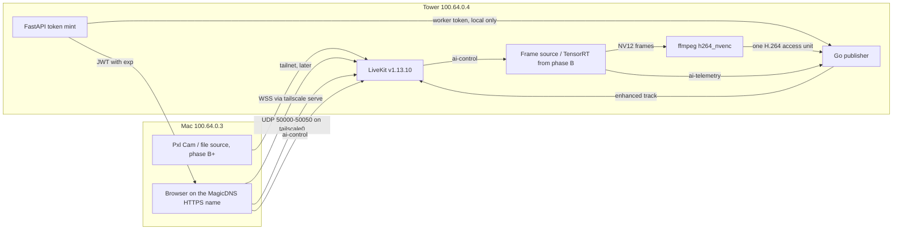

# Tower WebRTC runtime

**Status:** build bedrock
**Date:** 2026-10-24
**Canonical copy:** `pxl-cam/docs/TOWER_WEBRTC_PRODUCTION.md` on the Mac (`100.64.0.3`)
**This copy:** `pixelenhance-labs/docs/TOWER_WEBRTC_PRODUCTION.md`
**Companion docs:** `pxl-cam/docs/REALTIME_AI_STREAMING_AND_SUBMODULE_ARCHITECTURE.md`, `pixelenhance-labs/docs/streaming-and-webrtc.md`

This is the runtime the tower actually runs. The October architecture note is the product map (Pxl Cam, players, models, phases). This document is the media and GPU service underneath it.

The tower today is the test stand for a later RTX 5090. System RAM is 16 GB and moves to 48 GB first. The process split, the room protocol, the codec, and the token rules stay the same when the RAM kit and the 5090 arrive. What changes is the budget: resolution, which model may be resident, and whether AV1 encode exists.

---

## 1. Measured on the tower, 2026-10-24

Checked over SSH to `100.64.0.4`. These numbers override older notes that already describe 48 GB as installed.

| Item | Measured |
|---|---|
| OS | Ubuntu 24.04.4 LTS, kernel `6.17.0-35-generic` |
| CPU | 32 threads (Ryzen 9 5950X) |
| RAM | 15.53 GiB visible to Docker. `free` reports 15 GiB |
| Swap | 8 GiB swapfile, 1.1 GiB already used |
| `/dev/shm` | 7.8 GiB tmpfs, almost empty |
| GPU | NVIDIA GeForce RTX 3060, 12288 MiB, compute capability 8.6 |
| Driver / CUDA | 590.48.01 / CUDA 13.1 |
| Encode | System `ffmpeg` 6.1.1 has `h264_nvenc` and `hevc_nvenc`. `av1_nvenc` is compiled into ffmpeg. The 3060 has no AV1 encode silicon |
| GStreamer | 1.24.2 is installed. `nvh264enc`, `whipsink`, and `webrtcbin` are not installed |
| Docker | 29.3.1, `nvidia` runtime present, default runtime `runc` |
| Disk | `/` is 1.8 T, 93% used, 137 G free. `/mnt/storage` is the same filesystem |
| Port 8000 | Already bound on `0.0.0.0` and `[::]`. The media server does not take it |
| Health file | `/var/lib/tower-health/QUARANTINED.json` is absent. `/var/lib/tower-health/incidents/20261018` is present |
| Tailscale | Tower `100.64.0.4`. Mac `100.64.0.3`. ASUS `100.64.0.6` |

Kernel 6.17 stays. NVIDIA 590 does not build against kernel 7.0 on this machine. Driver 590.48 is already in the range an RTX 5090 requires (570 or newer). A 5090 install does not start with a kernel upgrade.

---

## 2. Hardware phases

The software shape is identical in all three phases. The gate in front of each phase is a pass/fail check, not a calendar hope.

### Phase A — now, 16 GB, RTX 3060

One room. One viewer on the Mac. Passthrough only: generate or read frames, encode once, play them back. No TensorRT model, no diffusion, no LL-HLS ladder, no public viewer.

Stop the run if swap used climbs during it. Available memory was about 12 GiB at measurement, with 1.1 GiB already sitting in swap. A CUDA context plus a model on top of that is a later phase.

### Phase B — 48 GB kit, still the 3060

The kit lands in about a week. The service that loads a model stays off until the kit has passed the RAM gate in section 12. After that gate:

- 1080p30 becomes the target, if the phase B numbers in section 11 pass
- one TensorRT engine may be resident
- a second engine may sit staged on disk, not pinned in RAM "just in case"
- LL-HLS stays the existing file packager. It does not run in the same hour as the live room on the 3060

### Phase C — RTX 5090, after phase B is green

Same LiveKit room, same tokens, same H.264 track, same data topics. Rebuild every TensorRT engine. The 3060 engines are `sm_86` and do not load on a 5090 (`sm_120`). AV1 encode is added only as a second layer after the H.264 gate is green again on the new card.

16 GB cannot host a 5090 workload. Phase B is the predecessor, not a parallel track.

---

## 3. Rules kept from the streaming doc

These stay in force:

1. The enhanced master is the source of truth. Models enhance. ffmpeg packages. The HLS ladder and the download transcode never upscale.
2. Live preview, HLS playback, and file download are three outputs of that master. A download is transcoded from the master, never from HLS segments.
3. A viewer is authenticated before the tower spends GPU time on them.
4. Control and telemetry travel with the stream, correlated by the frame PTS.
5. Real-time is a throughput budget. If the model cannot hold the frame interval, the mode is pre-render, then stream. WebRTC does not make the model faster.

---

## 4. Decisions

| Job | What the tower runs |
|---|---|
| Selective forwarder | LiveKit server `v1.13.10` (`livekit/livekit-server`), single node, no Redis |
| Access tokens | Python `livekit-api` `>=1.2.1`. Tokens carry an `exp` claim. FastAPI mints them after the existing user check |
| Publisher of the enhanced track | A small Go process on `github.com/livekit/server-sdk-go/v2`, `WriteSample` of already-encoded H.264 |
| Encoder | The system ffmpeg `h264_nvenc`, one encode per frame |
| Codec on the wire | H.264 Main, `yuv420p`, no B-frames |
| Signaling TLS | `tailscale serve` on the tower's MagicDNS name |
| TURN | `coturn`, installed later, left disabled while every viewer is on the tailnet |
| Inference | The existing TensorRT / pxl-engine worker, one engine resident, and only from phase B |
| VOD and downloads | Unchanged `streaming.py` / `export_stage.py` path |
| Metrics | LiveKit Prometheus on port 6789, tailnet only |

FastAPI stays the product API. It mints a token and records the session. It does not terminate WebRTC. The `aiortc` `EnhancedGpuTrack` sketch in the October note is not a service on this box. LiveKit Ingress is not deployed: Ingress transcodes, and this tower encodes once. LiveKit Egress is not deployed in phase A or B. GStreamer `nvh264enc` is not the encoder, because that plugin is not installed and ffmpeg NVENC already runs here.

Clients, when the players are wired, use the official LiveKit SDK for that platform (`livekit-client` on the web, `livekit_client` on Flutter, the official Swift and Android SDKs). Versions are pinned in the app lockfile at implementation time. The server pin above is the one that matters for the tower.

---

## 5. Shape



Two processes own the GPU path, and neither of them is the web server.

1. **Frame source.** In phase A this is an ffmpeg `testsrc` or a local file decode. From phase B it is the TensorRT worker. It writes NV12 frames and a PTS into a local socket. It also emits telemetry.
2. **Encoder plus publisher.** ffmpeg reads NV12 and writes H.264. The Go process reads one access unit at a time and publishes it into the room as track `enhanced`.

LiveKit forwards that track. It does not decode it and it does not encode it again.

A director (the Mac studio page, later `Player.tsx` or the fans admin panel) sends control on topic `ai-control`. The worker applies a control on the next frame it produces. Viewers subscribe to `enhanced` and may subscribe to `ai-telemetry`. Viewers do not publish.

Split-wipe for the editor is a client composite: the local raw frame and the remote `enhanced` track. The tower burns a wipe into `enhanced` only when a control message sets `split_wipe.broadcast` to true. That mode replaces the clean master for every viewer, so it is off unless a director turns it on.

---

## 6. Room, tokens, tracks

One LiveKit room per session: `pxl-{stream_id}`.

`stream_id` is `[A-Za-z0-9_-]{8,64}`. FastAPI creates the room through the server SDK. `empty_timeout` is 60 seconds. `departure_timeout` is 10 seconds. `max_participants` is 4 in phase A and B (worker, director, two viewers).

| Identity | Publish video | Publish data | Subscribe | Who holds the token |
|---|---|---|---|---|
| `tower-worker` | track name `enhanced` only | topic `ai-telemetry` | topic `ai-control` | the worker, from a local mint, never sent to a browser |
| `director-{user}` | no video | topic `ai-control` | `enhanced` and telemetry | an authenticated director |
| `viewer-{user}` | nothing | nothing | `enhanced` and telemetry | an authenticated viewer |

Token TTL is 10 minutes for a browser and 1 hour for the worker. Refresh is a new token from FastAPI, not a long-lived secret in the page. `livekit-api` 1.2.1 rejects tokens without `exp`. Every mint sets it.

The room allows one video codec:

```yaml
room:
  max_participants: 4
  empty_timeout: 60
  departure_timeout: 10
  enabled_codecs:
    - mime: video/h264
    - mime: audio/opus
  playout_delay:
    enabled: true
    min: 50
    max: 200
```

H.264 only, so a browser cannot negotiate VP8 and force a second encode. Audio is unused in phase A. Opus is listed so a later mic talkback does not require a config change. Playout delay stays on, with a short window, so one lost packet does not stall the picture for seconds.

---

## 7. Encode contract

Phase A output is 1280×720 at 30 fps, 2.5 Mbit/s CBR. Phase B target, only after the gate, is 1920×1080 at 30 fps, 6 Mbit/s CBR. Both are H.264 Main, no B-frames, GOP of 30 frames, IDR with SPS and PPS repeated on every keyframe.

```text
ffmpeg -hide_banner -loglevel error \
  -f rawvideo -pix_fmt nv12 -s 1280x720 -r 30 -i pipe:0 \
  -c:v h264_nvenc -preset p1 -tune ull -profile:v main -pix_fmt yuv420p \
  -bf 0 -g 30 -rc cbr -b:v 2500k -maxrate 2500k -bufsize 500k \
  -bsf:v dump_extra -an -f h264 pipe:1
```

The 1080p command is the same with `-s 1920x1080` and `-b:v 6000k -maxrate 6000k -bufsize 1200k`.

`av1_nvenc` and `hevc_nvenc` stay out of the test. The 3060 can encode HEVC, and Safari can play it, but Chrome across the fleet is the H.264 client. AV1 encode arrives with the 5090 and is a second simulcast layer, not a replacement of this command.

The Go publisher sends one access unit per `WriteSample`. ffmpeg's `h264` muxer emits Annex-B (start codes). Pion's sample path wants length-prefixed NALs. The publisher strips start codes and writes each access unit in the form `WriteSample` expects. Duration is `time.Second/30`. A sample that contains a B-frame is a bug. SPS/PPS ride with each IDR because of `dump_extra`.

NV12 crosses a Unix socket at `\0/pxl-tower/frames.sock`, one frame plus a little-endian PTS in a length-prefixed record. The socket directory is mode `0700` and owned by `pxltower`. The ring is four frames. At 720p NV12 that is about 5.5 MB. Nothing in this design allocates a multi-gigabyte ring in `/dev/shm`.

---

## 8. Data topics

Topic names match the October note so the players do not grow a second protocol. Messages are JSON, UTF-8, at most 8 KB. Unknown fields are ignored. An unknown `v` or `type` draws a `rejected` telemetry message and changes nothing.

### `ai-control` — reliable, director to worker

```json
{
  "v": 1,
  "type": "update_pipeline",
  "mode": "passthrough",
  "denoise_strength": 0.0,
  "face_enhance": { "enabled": false, "model": "", "strength": 0.0 },
  "face_reage": { "enabled": false, "model": "", "target_age": 0, "strength": 0.0 },
  "diffusion": { "enabled": false, "prompt": "", "strength": 0.0 },
  "split_wipe": { "broadcast": false, "position": 0.5 }
}
```

Phase A accepts `mode: "passthrough"` only. Any other mode gets `rejected` with `reason: "mode_not_loaded"`. Phase B adds `mode` values one at a time, after that model has passed the timing gate on its own.

`target_age` is an integer 18–80 when re-aging is enabled. The worker clamps it. It does not guess.

### `ai-telemetry` — lossy, worker to room, at most 15 Hz

```json
{
  "v": 1,
  "type": "frame_telemetry",
  "pts": 904500,
  "mode": "passthrough",
  "width": 1280,
  "height": 720,
  "fps": 30.0,
  "gpu_ms": 0.0,
  "encode_ms": 2.1,
  "vram_used_mb": 234,
  "ram_available_mb": 11000,
  "swap_used_mb": 1126
}
```

`pts` is the PTS of the access unit just published. A director correlates boxes and HUD lines to that PTS, not to "whatever frame is on screen." Telemetry is not sent once per frame above 15 Hz. At 30 fps the worker sends every other frame.

`rejected` uses the same topic:

```json
{ "v": 1, "type": "rejected", "reason": "mode_not_loaded", "mode": "diffusion" }
```

---

## 9. Where the pieces live

Host user `pxltower`, groups `video` and `render`. Home `/var/lib/pxl-tower`. No service runs as root.

| Path | Purpose |
|---|---|
| `/etc/pxl-tower/livekit.yaml` | LiveKit config. Mode `0640`, root:`pxltower`. API secret lives here and nowhere else |
| `/etc/pxl-tower/livekit.env` | `LIVEKIT_API_KEY` and `LIVEKIT_API_SECRET` for the minter. Mode `0640` |
| `/etc/systemd/system/pxl-livekit.service` | Docker LiveKit, host network |
| `/etc/systemd/system/pxl-publisher.service` | Go publisher + ffmpeg |
| `/etc/systemd/system/pxl-frames.service` | Frame source. Phase A is the test pattern. Phase B is the model worker |
| `/run/pxl-tower/` | Sockets. tmpfs, mode `0700` |
| `/var/lib/pxl-tower/models/` | One staged engine in phase B. Cap the directory at 20 G with a quota or a deploy check |

`livekit.yaml` for this machine:

```yaml
port: 7880
rtc:
  port_range_start: 50000
  port_range_end: 50050
  tcp_port: 7881
  use_external_ip: false
  node_ip: 100.64.0.4
  interfaces:
    includes:
      - tailscale0
  ips:
    includes:
      - 100.64.0.4/32
prometheus:
  port: 6789
logging:
  level: info
  json: true
keys:
  # generated on the tower, never committed
  pxl_tower: replace-with-livekit-keygen
room:
  max_participants: 4
  empty_timeout: 60
  departure_timeout: 10
  enabled_codecs:
    - mime: video/h264
    - mime: audio/opus
  playout_delay:
    enabled: true
    min: 50
    max: 200
limit:
  num_tracks: 16
  subscription_limit_video: 2
```

No `redis:` block. One node. `use_external_ip: false` so the server does not STUN-discover the home router and hand a LAN or WAN address to a tailnet client.

Generate the key pair with the image's `livekit-server generate-keys` and write it into the yaml and the env file in the same step. The placeholder above must not boot.

Docker:

```text
docker run --rm --name pxl-livekit \
  --network host \
  -v /etc/pxl-tower/livekit.yaml:/etc/livekit.yaml:ro \
  livekit/livekit-server:v1.13.10 \
  --config /etc/livekit.yaml
```

Pin the image by digest in the unit once the tag is pulled, and record the digest in the unit file comment. The systemd unit sets `MemoryMax=512M` on the container cgroup. LiveKit does not see the GPU.

The frame and publisher units set:

- `MemoryMax=1G` on the publisher (ffmpeg + Go)
- `MemoryMax=2G` on the phase A frame source
- `MemoryMax=8G` on the phase B model worker, and only after the 48 GB gate
- `ConditionPathExists=!/var/lib/tower-health/QUARANTINED.json` on the frame source and the publisher

If that quarantine file exists, those units do not start. LiveKit may still start. It has nothing to publish.

Port 8000 is already taken. Nothing in this runtime binds it.

---

## 10. Network

Viewers in phase A and B are on the tailnet. The Mac and the ASUS already are. A phone viewer joins the tailnet. The tower is not a public WebRTC origin: it is a home machine, and public fans keep using HLS.

Signaling is HTTPS because a browser will not open `RTCPeerConnection` on `http://100.64.0.4`. On the tower:

```text
tailscale serve --bg --https=443 http://127.0.0.1:7880
```

The browser uses `wss://<tower MagicDNS name>`. Print the name with `tailscale status` on the tower. ICE uses host candidate `100.64.0.4` and UDP 50000–50050 on `tailscale0`. That range is intentionally small. One room does not need ten thousand ports.

LiveKit with `--network host` would also listen on the LAN. An extra nftables table drops the media ports on every interface except the tailnet and loopback. It does not flush existing tables.

```nft
table inet pxl_tower {
  chain input {
    type filter hook input priority -10; policy accept;
    iifname "tailscale0" tcp dport { 7880, 7881, 6789 } accept
    iifname "lo" tcp dport { 7880, 7881, 6789 } accept
    iifname "tailscale0" udp dport 50000-50050 accept
    tcp dport { 7880, 7881, 6789 } drop
    udp dport 50000-50050 drop
  }
}
```

Load it with `nft -f` of that table only. Confirm with `nft list table inet pxl_tower` before starting LiveKit.

TURN and a public edge are a later project. When a viewer must sit off the tailnet, the public SFU or `coturn` belongs on the Hetzner host, which has a real address. The tower keeps publishing. The home router does not grow a UDP forward. That work is out of scope until phase B is green.

---

## 11. Pass gates

A phase is done when its row is true on a real Mac viewer, over the tailnet, for a continuous 10 minutes. A burned-in timestamp or a clap measures glass-to-glass. A guess does not.

| Check | Phase A, 720p30 passthrough | Phase B, 1080p30, one model |
|---|---|---|
| Picture | Continuous motion, no freeze over 500 ms | Same |
| Glass-to-glass | p95 under 400 ms | p95 under 400 ms |
| `encode_ms` | p95 under 8 ms | p95 under 8 ms |
| `gpu_ms` | n/a | p95 under 25 ms |
| Frames | Published fps stays at 30, drops under 1% | Same |
| Swap | `swap used` does not rise during the run | Same, and idle swap is near empty after the kit |
| VRAM | Flat after startup | Flat after startup, no climb |
| Telemetry | `pts` matches the published access unit | Same, and a control change is visible within 500 ms |
| Restart | `systemctl restart` of the three units returns the picture with no hand steps | Same |
| Quarantine | With a **temporary** flag pointed at `/tmp`, the frame unit refuses to start. Do not create a file under `/var/lib/tower-health` for this test | Same |
| Codec | Browser decoder reports H.264. No VP8, no software encode on the tower | Same |

Record the run in the journal: one JSON line a second from the publisher with fps, encode_ms, drops, vram, ram available, swap used. Secrets never go in that line.

Phase A is allowed to be test-pattern frames. Phase B's first model is one face or denoise engine at 1080p, alone. Diffusion, re-aging, and upscale are additional phase B modes, each with its own 10-minute row. They are not stacked in one pipeline on the 3060.

4K live AI is a phase C measurement. It is not a phase A or B promise. If a model misses the frame interval, that mode is a pre-render into the master file, then the existing HLS path. That is the streaming doc's rule, applied to this GPU.

---

## 12. RAM kit gate

The 48 GB kit is a hardware change on a board that already has an October 2026 memory incident on disk. The model worker stays disabled until all of the following are true:

1. The new modules are seated in the slots the board manual calls the correct pair for a 2-DIMM population. Trust the silkscreen.
2. XMP stays off. The existing BIOS choices stay: idle control, C-states, Secure Boot, PBO. Do not load optimized defaults, and do not flash, as part of seating RAM.
3. memtest86+ from GRUB completes the pass count already required for a stick to be trusted, with zero errors, and the result is written down.
4. After boot, `free -h` shows about 48 GB, and swap used is near zero at idle with the usual services up.
5. `/var/lib/tower-health/QUARANTINED.json` is still absent. If a quarantine file is created during the swap, the frame unit will not start, and that is the intended behavior.

Until those are true, the only legal stream is phase A passthrough.

Disk stays a constraint after the RAM upgrade. 137 G free is enough for one staged engine and the containers. It is not enough for a diffusion archive. Weights live on the ASUS model store or in B2. The tower copies the one engine it is about to run.

---

## 13. RTX 5090 swap

Do this after phase B is green, not before.

1. Confirm the PSU and the chassis. A 5090 is a 575 W-class card. This document does not record a PSU measurement.
2. Shut down cleanly. Seat the card. Boot the same kernel, `6.17.0-35-generic`.
3. `nvidia-smi` must list the 5090 on driver 590.48 or a newer 590-series build that still compiles for 6.17. If it does not, fix the driver on this kernel. Do not move to kernel 7.0.
4. Remove `sm_86` TensorRT engines from `/var/lib/pxl-tower/models/`. Rebuild from the same ONNX for `sm_120`. An engine built on the 3060 is not a 5090 engine.
5. Re-run the phase A gate unchanged: 720p30 H.264, one Mac viewer, same 400 ms / swap / restart checks. The media path has to survive the card swap before any new budget is used.
6. Re-run the phase B gate at 1080p30.
7. Only then measure a higher budget. Candidates, each alone, each with a written p95: 1080p60 H.264, 4K30 H.264, one diffusion mode. AV1 is a second simulcast layer from `av1_nvenc` after the H.264 layer is green. H.264 remains the track every browser can decode. The 5090 has AV1 encode hardware (three NVENC engines, H.264, HEVC, and AV1). The 3060 does not, which is why `av1_nvenc` in today's ffmpeg binary is unused.
8. VRAM is 32 GB on a 5090, against 12 GB today. The resident-pipeline rule stays: one heavy mode at a time until a stacked mode has its own passing 10-minute row. Host RAM does not substitute for a model that does not fit in VRAM.

The room name, the token grants, the topic names, and the JSON `v: 1` schema do not change in this swap.

---

## 14. Failure behavior

| Event | What happens |
|---|---|
| Quarantine file appears | Frame source and publisher do not start. A running frame unit is stopped by the operator. LiveKit stays up and idle |
| Worker crashes | Publisher stops sending. Viewers freeze on the last frame, then the SFU signals unpublish. systemd restarts the worker. The worker rejoins the same room with a new token |
| Mac sleeps | Room hits `departure_timeout` and closes. Next play is a new token |
| Swap climbs during a run | Stop the frame unit. The run is a fail. Do not raise `MemoryMax` to hide it |
| Disk under 40 G free | Do not stage a model. Passthrough may run |
| Control asks for a model that is not loaded | `rejected`, picture stays on the current mode |
| Browser offers VP8 | Room codec list refuses it. Fix the client. Do not turn VP8 on to make the page happy |
| Tailscale down | No viewers. Do not fall open to `0.0.0.0` |

Logs are journald, JSON, `SyslogIdentifier` set per unit. A token, a key, and an SDP body are not log fields.

---

## 15. What the other machines keep

| Work | Machine |
|---|---|
| Camera app, MetalFX, CoreML, virtual camera, OBS dock | Mac |
| Model warehouse, `sm_75` checks | ASUS |
| Token API, HLS ladder, master download, web player | `pixelenhance-labs`, talking to the tower for the live track |
| Fans mass live | Existing RTMP → HLS path until a public SFU exists. VIP WebRTC is a tailnet director in this bedrock, not a public 4K room |
| This runtime | Tower |

Pxl Cam becomes a publisher into the same room in a later phase: it joins as a source, the worker subscribes, enhances, and republishes `enhanced`. That uses the same token and track rules. It is not required for the phase A gate.

---

## 16. Bring-up order

Do these in order. Stop at the first failure.

1. Create `pxltower` and `/etc/pxl-tower`. Generate keys. Write `livekit.yaml` and `livekit.env`. Mode `0640`.
2. Install the nftables table. Confirm the media ports are refused on the LAN address `192.168.1.129` and accepted on `100.64.0.4`.
3. Start LiveKit. `curl` the health endpoint on `127.0.0.1:7880`. Prometheus on `127.0.0.1:6789/metrics` returns LiveKit series.
4. `tailscale serve` for HTTPS. From the Mac, the MagicDNS name presents a certificate and the signaling port.
5. Start the phase A frame source and the publisher. A Mac page with a director token shows the test pattern for 10 minutes and the phase A row passes.
6. Stop there until section 12 is true.
7. Stage one engine from the ASUS store. Run that mode alone. Record the phase B row.
8. Wire `Player.tsx` and the fans admin panel to the official client SDKs, still against this room and these topics.

A page that works for a minute and was not timed is not a pass.

---

## 17. Out of scope for this bedrock

These are real follow-ons. They are not quietly included.

- Public viewers, home-router port forwards, and TURN
- LiveKit Ingress, LiveKit Egress, Redis, a second LiveKit node
- LL-HLS produced from the live encode on the 3060
- Stacked upscale + face + diffusion in one frame
- 4K or 8K live output on the 3060
- AV1 on the 3060
- Replacing the HLS or download pipeline
- MetalFX, CoreML, and the OBS dock
